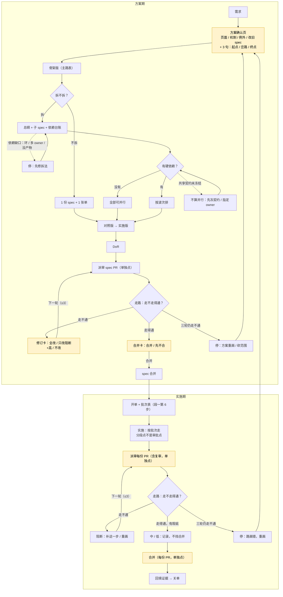

# spec：一份 spec 一条路（流程收敛）

- 日期：2026-11-03
- Issue：待开（spec 合并后）
- 状态：草案（R1 / R2 已修订，待 R3 复核）
- 决策人：用户
- 决策来源：2026-11-03 对话。用户原话「大道至简」「不喜欢添油加醋的打补丁」「方案出来一定要和用户确认」「派出复审也需要人工确认」「如果三轮都审不过还有 major 或阻断则应该重新梳理闭环性」。
- 结构：**不拆**（按 2026-11-03 批准的图；1 份 spec + 1 张执行 issue；理由：所有改动共享同一条主线与同一份 `SKILL.md` 预算，拆开会多份当前真相；你在合并卡可改）。
- 基线：`main@a9b7c1c`
- 上游：`references/spec-maturity.md`、`references/gate-details.md`、`references/phase-handoff.md`、`references/split-large-spec.md`、`references/rationale.md`

## 1. 问题：spec 是文档，不是路

现行 spec 是一堆章节：目标、背景、规则、数据、验收分散在各节，审核逐段找矛盾。每轮审核从不同段落采样，必然抓到新的“owner 冲突 / 自相矛盾 / 计数不符”；作者再补一段，副本又多一处。这不是需求错，是承载方式错。

三个样本（数字取自 PR #871 评论与 R34；本轮未回原始 issue 复核）：

- **#871（本轮）**：一天至少 4 轮完整重审；第 2 轮 0 阻断 / 8 高 / 35 中 / 54 低（97 条），第 3 轮后阻断又回来；审核自己写「根因是模型层重做未回灌契约 / S01 旧副本」。
- **#608（反面）**：29 天写完才写第一行代码；46 条评论、一份 spec 39 次提交；主 spec 810 行、110 个验收框未勾；四波实施 PR 各 30 / 33 / 23+ / 22 条评审发现。
- **#159（正面）**：设计稿先当靶子，spec 期 29 条发现（1 高 / 12 中 / 16 低）在写代码前改掉；实施期只剩 8 条（1 高 / 3 中 / 4 低）；spec 合并到发版 77 分钟。

结论：不是缺账本、缺卡、缺轮次，是 **spec 没有一条能从头走到尾的路**。没有路，审核只能逐段找矛盾；有了路，审核只问“走不走得通”。

现行“骨架版 + 四列对照”已经是路的种子；本 spec 把它扶正为整份 spec 的主线，替换列定义、补“失败 / 空态”，删掉后来长出来的旁支。

### 1.1 六个诉求与落点

| 诉求 | 落点 | 验收 |
|---|---|---|
| 1 多阶段不问 | 方案页 + 拆分卡 + 交付卡；阶段之间不问 | V04、V08 |
| 2 issue 并行 / 批次 | 一条能独立走通的路 = 一份 spec = 一张单；开单即出批次表 | V07 |
| 3 N 轮阻断、三轮重梳 | 走路审核：R1 全量 / R2 只核关闭 / R3 停 | V05、V06 |
| 4 方案和代码闭环、交互确认、派审确认 | 每步有落点与证据；方案页看路答 3 句；派审 / 合并单独点 | V03、V04、V05、V08 |
| 5 目标不散、决策过程 | 起点 / 终点是目标；岔口写谁拍 / 日期；汇报第一行复述 | V04、V08 |
| 6 确认再动手 | 没确认方案页，不写 spec、不动代码 | V04 |

## 2. 调研

| 说法 | 出处 | 对本 spec 的含义 |
|---|---|---|
| SDD 有 spec-first / spec-anchored / spec-as-source 三级；文档一多就重复、漂移；她的判断是：宁愿审代码，也不想审这一堆 markdown | [Böckeler 2025](https://martinfowler.com/articles/exploring-gen-ai/sdd-3-tools.html) | 少写散文，多写一张可走的路；文档副本越多，越难闭环 |
| tasks 用 `[P]` 标可并行，按阶段 / 用户故事分组，带依赖与执行顺序，阶段末 `STOP and VALIDATE` | [GitHub Spec Kit tasks 模板](https://github.com/github/spec-kit/blob/main/templates/tasks-template.md) | 批次表不是新发明：并行标记 + 硬前置 + 阶段校验 |
| agent 需要 human checkpoint、最大迭代次数；evaluator-optimizer 只在判据清晰时有效 | [Anthropic Building effective agents](https://www.anthropic.com/engineering/building-effective-agents) | 派审 / 合并是人工检查点；R3 是最大迭代 |
| 上下文变长会 context rot；结构化笔记与压缩要保留决定 | [Anthropic context engineering](https://www.anthropic.com/engineering/effective-context-engineering-for-ai-agents) | 目标、决定、验收必须在上下文外持久化，不能只靠聊天记忆 |
| 评审标准是“有改进且无阻断就合”，不追求完美；中 / 低标 Nit；僵持就升级 | [Google code review standard](https://google.github.io/eng-practices/review/reviewer/standard.html) | 中 / 低不挡合并；R3 僵持就停，不再加一轮 |

## 3. 目标与非目标

### 目标

- **一份 spec 一条路**：起点、终点、步骤、失败 / 空态、证据；每条规范句挂一个步号。
- **方案页一次呈现**：页面 / 机制 / 例外 / 改旧 spec 四个独立选择 + 3 句（起点 / 岔路 / 终点）；拆分卡在骨架后；交付卡按 PR。
- **走路审核**：R1 全量、R2 只核关闭、R3 停；阻断 / 高不合并；中 / 低不挡合并；复审重新点卡。
- **开单即出批次表**：一条能独立走通的路 = 一份 spec = 一张单；几条路能同时走 = 批次表。
- **保留判断权与安全阀**：两段流程、worktree 锁、合并确认、审核档位、完成标准不变。

### 非目标

- 不新增决策账本、验收矩阵、状态机、插件、Hook、CI。
- 不迁移旧 spec；旧 spec 只读收尾。
- 不改两段流程、worktree 锁、合并授权、审核档位、完成标准。
- 不提高 `SKILL.md` 预算（4,700 字符）。
- 不把 #608 的业务方案写进本 spec。
- 不自动派审、不自动合并、不把“方案页”当派审授权。
- 不批量重命名 references 中的卡名引用（实测 124 处 / 9 个文件 / 78 行）；只改用户看到的摆法。

## 4. 机制清单

| # | 机制 | 解决什么 / 没有它会怎样 |
|---|---|---|
| 1 | **一条路**：起点 / 终点 / 步 / 失败 / 证据 | 解决：把 spec 从段落堆变成可走的路；没有它：审核逐段找矛盾，永远找得完 |
| 2 | **方案页**：4 个独立选择 + 3 句 | 解决：一次看全方案，又不吞掉各卡的独立点头；没有它：逐张卡跑，或没确认就开干 |
| 3 | **走路审核**：R1 / R2 / R3 | 解决：给审核一个停止规则；没有它：N 轮全量扫，阻断反复，用打补丁代替重画 |
| 4 | **派审 / 修订 / 合并单独点**（含复审） | 解决：把质量门和“继续做”分开；没有它：方案页被当成派审授权，复审自动派出 |
| 5 | **开单批次表**：按路拆、按硬依赖排波次 | 解决：让用户一眼看到先做谁、谁能并行；没有它：自己猜先后，伪并行，合并撞车 |
| 6 | **目标锚**：起点 / 终点 / 岔口决定 / 汇报复述 | 解决：把目标钉在上下文外；没有它：越聊越散，最终拿不准目标 |

> 8 张卡名保留（页面 / 拆分 / 机制 / 例外 / 改旧 spec / 派审（原闸卡） / 修订 / 合并），供现有 references 引用；用户看到的摆法从“逐张卡单独停”改为“方案页同页逐项点 + 拆分卡 + 每份 PR 按需点”。

## 5. 详细规则

### 5.1 一条路

**写法**：

- 开头两行：`起点：…`、`终点：…`；各一句，可观察。
- 主表四列：**步 | 触发 → 响应 | 失败 / 空态 | 落点 · 依据 · 证据**。
- 每条规范句必须挂一个步号；挂不上 = 不写。
- 岔口的决定写在步旁：`D01 结论｜谁拍｜日期`；agent 自定标 `自定`。
- 多阶段 = 路的段；分段点是步骤，不是审批点。
- 复杂需求 = 一条主路 + 3–5 条关键岔路；岔路多了 = 该拆单，不是写更长。
- 非目标 = 不走的岔路，写在起点旁。
- 证据必须可执行（命令 / 断言 / 截图）；观察式例外按 `references/done-criteria.md`。
- 大 spec 允许附表；首页只放主路和索引；同一决定只能有一个正文 owner。

**列映射**：主表四列**替换**现行四列，不是“补一列”。

| 现行 | 新表 |
|---|---|
| 流程节点 | 步 |
| 界面或样例 | 触发 → 响应 |
| 数据或接口 + 验收 | 落点 · 依据 · 证据 |
| —（新增） | 失败 / 空态 |

旧四列不再单独存在；对照表里的界面 / 数据 / 验收折进这四列。本次改动**无用户界面**；样例 = 主路表 + 批次表 + 方案页骨架。

**主路与分支**：

黄底 = 人工确认点；实线 = 主路；虚线 = 分支 / 回路。

### 5.2 方案页

方案页只做四件事，**四个选择各自独立点，不合并成一个“确认”**：

| 选择 | 选项 | 没点 |
|---|---|---|
| 页面 | 出设计稿 / 不出，用样例 | 停住，等用户选 |
| 机制 | 全要 / 全砍 / 逐项挑 | 不出 spec |
| 例外 | 纳入 / 不纳入 | 按“不纳入”走 |
| 改旧 spec | 新开一份 / 改旧的 | 不动笔 |

再加 3 句附加确认：

1. 起点对不对？
2. 岔路选哪个？
3. 终点是不是你要的？

- 拆分不在这一页：骨架成形后单独摆拆分卡（见 §5.4）。
- “改旧 spec”只在动已合并 spec 时出现；新 spec 写“不适用”。
- 交互 = 谁在什么时候看到 / 点什么；无界面改动写 3–5 个关键动作 / 判断点。
- 用户改：改这页，重问 3 句；不新开卡。
- 没确认：不写 spec、不动代码、不开 issue。
- 方案页不包含派审授权；派审 / 复审仍单独点。

### 5.3 走路审核

| 轮 | 做什么 | 出什么 |
|---|---|---|
| R1 | 从起点走到终点，每步核触发 / 响应 / 失败 / 证据；发现挂步号 | 阻断 / 高 / 中 / 低 |
| R2 | 只核上轮发现是否关闭 + 是否新增阻断 / 高；新中 / 低只记录 | 关闭率 + 新阻断 / 高 |
| R3 | 仍有阻断 / 高：停，不再派第 4 轮同款 | 重画 / 砍范围 / 停，三选一由用户拍 |

**严重度**：

- **阻断**：走不通；证据不可执行；同一决定多 owner；岔路未选；数据 / 安全 / 权限问题。
- **高**：会导致返工或跨份不一致，但本轮可修。
- **中 / 低**：不挡合并；记录，列进合并卡的未处理项。
- 涉及数据丢失 / 安全 / 权限的，一律阻断，不管谁标的中 / 低。

**合并标准**：有改进且**无阻断、无高**就合，不追求完美（Google）。中 / 低不挡合并；未处理项写进合并卡。

**修订卡**（有发现时）：

- 全改 / 只改阻断+高 / 不改。
- 选“不改”且仍有阻断 / 高：不合并。
- 选“只改阻断+高”：中 / 低列进合并卡未处理项，可合并。
- 这条明确取代 `gate-details.md:14`「没答或选不改不合并」和 `:36`「不把合并卡当作绕过待决修订的出口」中**仅对中 / 低**的部分；阻断 / 高仍不合并。

**复审**：每次复审 = 新的一次派发 = 新摆一张派审卡；修订选择只授权修改，不授权再派。

**必问一句**：有没有该走没走的岔路？没有这一问，路只覆盖写出来的，漏掉没想到的。

**发现挂步号**：挂不上的发现只作建议，不升阻断；防止用泛泛的“质量意见”扩大战场。

### 5.4 拆分与批次表

- 拆分卡在**骨架版成形后**摆，不在方案页提前定；选项：拆 / 不拆，推荐在前。
- 一条能独立走通的路 = 一份 spec = 一张单；不能独立走通的，先画通再开单。
- 开单报告附批次表：**批次 | issue | 产物 | 前置 | 并行组 | 合入 / 发布**。
- **批次表不另建表**：拆分组 = 总纲交付物地图的派生视图；不拆 = 该 spec 的交付物清单 / 主路表为源。两种形态都由 spec 层做唯一 owner，批次表只做 issue 层渲染；字段冲突以 spec 层为准。
- 没有硬依赖：写“全部可并行”；单 issue：写“本批不拆，无并行项 + 原因”。
- 共享契约 / 同一决定：未冻结不算并行；冻结后指定唯一 owner，其余引用。
- 依赖缺口（环 / 多 owner / 没产物）：停，先修拆法，不猜、不开单。
- 表贴到父单 / 交接报告；用户不用自己从地图里推。

### 5.5 执行

- 方案页 + 拆分卡确认后，覆盖整份 spec 的所有阶段；阶段之间不问“要不要继续”。
- 只在预声明停止点停：**新岔路 / 新决定、生产写、不可逆迁移、外部契约变更、范围变化、闭环破裂**。
- 每份 PR：派审卡 + 修订卡（如有发现）+ 合并卡；都由用户点；派审卡含复审。
- 每次汇报第一行复述起点 / 终点原文；新想法先判“是不是这条路上的一步”；不是则归入非目标或新路，不直接写进 spec。
- 波次边界只报进度，不请求续做许可。
- 停止点之外，agent 自己组织开发；不逐阶段问。

### 5.6 与既有规则的关系

**保留**：两段流程（段一 1–6、段二 7–9 编号不动）；判断权（方案页 / 拆分 / 派审 / 修订 / 合并）；worktree 锁；合并确认；审核档位；完成标准；拆分规则；ADR 选修；旧 spec 只读收尾。

**改变**：

- 卡片总表从 8 行平铺改为 2 组、3 类确认：**方案组**（页面 / 机制 / 例外 / 改旧 spec，同页逐项点；拆分在骨架后单独点）+ **交付组**（派审（原闸卡） / 修订 / 合并，每份 PR 按需点）；3 类确认 = 方案页 / 拆分 / 交付。
- 方案组 5 卡与派审卡的选项 / 默认值不变；修订卡从 2 选项改为 3 选项（全改 / 只改阻断+高 / 不改），闸卡显示名改为“派审”（语义不变），属显式变更；选项 / 默认值从 `SKILL.md` 移入 `references/one-path.md`，`SKILL.md` 只留 2 组 + 指针。
- 新增 `references/one-path.md`，承载路模板、写法、审核清单、批次表样例、3 句确认、8 卡选项 / 默认值。
- 审核细则进 `gate-details.md`；阶段 / 停止点进 `phase-handoff.md`；按路拆与批次表进 `split-large-spec.md`；方案页 / 骨架后拆分进 `spec-maturity.md`；“工作区与锁”细则进 `worktree-lock.md`。

**不新增**：账本、矩阵、状态机、插件、Hook、CI、自动派审、自动合并。

**迁移 / 回滚 / 兼容**：

- DoR 5 不适用：纯 Markdown，无数据迁移 / 回填；回滚 = revert 本 PR；兼容 = 旧 spec 只读，不迁移。
- DoR 6 不适用：本仓是文档仓，无对外合同 / 版本兼容面。
- DoR 7 不适用：本仓未采用 ADR。

## 6. 改动面

| 文件 | 改动 |
|---|---|
| `SKILL.md` | 主线改为「需求 → 方案页 → 骨架 → 拆分 → 对照 / 实施版 → DoR / 派审 / 合并 → 开单 / 批次表 → 实施 → 派审 / 修订 / 合并 → 回填」；第 2–4 步改写；卡片总表 8 行改 2 组；第 6 步加批次表；第 7–9 步保持编号；参考表加 `one-path.md`，`worktree-lock.md` 读取时机改为「文件变更 / 认领 / 撞锁 / 放锁」；正文 ≤ 4,700 |
| `references/one-path.md`（新） | 路模板、起点 / 终点写法、D/A 挂法、失败列、审核清单、批次表样例、3 句确认、8 卡选项 / 默认值 |
| `references/gate-details.md` | 审核改为走路；R1 / R2 / R3；严重度；阻断 / 高不合并、中 / 低不挡；复审重新摆卡；发现挂步号；修订卡三选项；明确取代 `:14` / `:36` 的中 / 低部分 |
| `references/phase-handoff.md` | 交接区加“阶段 / 停止点”；一次授权覆盖整份 spec；阶段之间不问；派审 / 修订 / 合并仍单独点 |
| `references/split-large-spec.md` | 拆分卡在骨架后；按“能独立走通的路”拆；批次表按路派生（拆 = 总纲地图；不拆 = 该 spec 清单）；共享契约 / 依赖缺口处理 |
| `references/spec-maturity.md` | 骨架版 = 路的第一屏；方案页 4 个选择 + 3 句；拆分在骨架后；设计稿 / 样例 = 路的可视 / 可执行靶子 |
| `references/worktree-lock.md` | 接收“工作区与锁”细则：fetch / origin worktree / pwd / 认领 / 放锁；主文件留一行指针 |
| `references/rationale.md` | 新增 R35：一条路、3 轮熔断、派审确认、批次表；记录来源、决定、代价、验证边界 |
| `README.md` / `README.zh-CN.md` | 流程、2 组卡 / 3 类确认（方案页 / 拆分 / 交付）、R1–R35、`one-path.md`；节标记一一对应 |
| `scripts/check-docs.sh` | 不改逻辑；新 reference 自动纳入存在性检查；语义靠人工 |

### 6.1 预算

当前 `SKILL.md` 正文 4,700 / 4,700，余量 0。

- 卡片总表 8 行（约 477 字符）→ 2 组 + 指针（约 180）；8 卡选项 / 默认值移入 `one-path.md`：约 **−300**。
- “工作区与锁”305 字符移进 `worktree-lock.md`，主文件留一行（约 50）：约 **−255**。
- 主线 / 第 2–4 步 / 第 6 步改写：约 **+120**。
- 参考表加 `one-path.md`、改 `worktree-lock.md` 读取时机：约 **+50**。
- 复审 / 修订 / 批次表规则：约 **+50**。

预计净减约 **−335**；目标仍 ≤ 4,700。实施时逐节实测；若超，按“先压缩措辞、再移细则”处理，不删承重规则，不提高预算。

### 6.2 文档检查边界

`check-docs.sh` 现行检查：正文 / frontmatter / 整份预算、references 路径与相对链接、README 双语节标记与 references 点到、发布纪律 / 发布闭环四节、采用契约。它不检查卡片分组、R 范围、语义闭环；卡片分组 / 8 卡默认值在 V02 / V10 人工核对，R 范围在 V02，语义闭环在 V11。本 spec 不新增脚本。

## 7. 验收

每条验收在实施 PR / issue 留**输入、期望、实际、证据**；未跑的交互演练标“未验收”。

- **V01** `bash scripts/check-docs.sh` 绿；`SKILL.md` 正文 ≤ 4,700、整份 ≤ 5,200、警示符 ≤ 3。
- **V02** 两份 README 节标记一一对应；正文写“R1–R35”；文件表都点到 `references/one-path.md`；`rationale.md` 末尾确有 R35、R1–R35 连续；`SKILL.md` 卡片总表为 2 组 + 指针，`one-path.md` 含 8 卡选项 / 默认值；抽 6 个默认值核对不丢（不审 / 不合 / 不出 spec / 不纳入 / 不动笔 / 不开单）；修订卡 3 选项、闸卡显示名“派审”为显式变更，逐项核对。
- **V03** 用 spec-flow 自己的“开单出批次表”做样例，产出一条路：起点 / 终点各一句；≥4 步；每步有触发 → 响应、失败 / 空态、证据；每条规则挂步号；样例里不出现 #608 的业务词。
- **V04** 方案页含页面 / 机制 / 例外 / 改旧 spec 四个独立选择 + 3 句；拆分卡在骨架后；每个选择有自己的选项与默认值；无界面改动写 3–5 个关键动作 / 判断点；未确认时无 spec 正文、无代码、无 issue；样例骨架 = §5.2 的字段清单。
- **V05** 模拟 R1 发现阻断 / 高 → R2 只核关闭 → R3 仍有阻断 / 高：触发“重画 / 砍范围 / 停”三选一，不派第 4 轮；复审重新摆卡；修订选择不自动派审。
- **V06** 阻断 / 高不合并；中 / 低不挡合并，列进合并卡未处理项；数据 / 安全 / 权限问题无论标什么级别都阻断；修订卡“不改”且仍有阻断 / 高时不合并。
- **V07** 批次表覆盖五种形态：单 issue（不拆 + 原因）、多 issue 无依赖（全部可并行）、有硬依赖（波次）、共享契约未冻结（不算并行）、依赖缺口（停）；表贴到父单 / 交接报告；拆分组以总纲地图为源，不拆以该 spec 交付物清单 / 主路表为源，两种形态都不另建表。
- **V08** 方案页 + 拆分卡确认后覆盖多阶段；阶段之间不问“要不要继续”；只在六个停止点停；每次汇报第一行复述起点 / 终点；每份 PR 派审 / 修订 / 合并按需点。
- **V09** 两段流程、worktree 锁、合并确认、审核档位、完成标准不变；旧 spec 不迁移；段一 1–6、段二 7–9 编号不动；拆分卡在骨架后，不在方案页提前定。
- **V10** 不新增账本 / 矩阵 / 状态机 / 插件 / Hook / CI；不自动派审 / 自动合并；卡名未批量重命名；8 卡默认值不丢；未确认方案页不动手。
- **V11** 六诉求逐条对照：§1.1 每条都有落点与验收；抽 5 条规范句，确认都挂步号；没有挂步号的 = 未通过；语义闭环以此为准。

## 8. 自定细节

- **新文件名**：`references/one-path.md`。
- **卡片分组**：方案组（页面 / 机制 / 例外 / 改旧 spec 同页逐项点；拆分在骨架后单独点）+ 交付组（派审（原闸卡） / 修订 / 合并，每份 PR 按需点）；2 组卡、3 类确认；方案组 5 卡与派审卡选项 / 默认值不变，修订卡 2→3 选项、闸卡显示名→派审为显式变更；选项 / 默认值移入 `one-path.md`。
- **3 句确认**：起点对不对 / 岔路选哪个 / 终点是不是你要的。
- **严重度**：阻断 = 走不通 / 证据不可执行 / 多 owner / 岔路未选 / 数据安全权限；高 = 会返工；中低 = 不挡合并。阻断 / 高都不合并。
- **修订卡**：全改 / 只改阻断+高 / 不改；不改且仍有阻断 / 高则不合并。
- **主表列名 / 顺序**：步 / 触发 → 响应 / 失败 / 空态 / 落点 · 依据 · 证据。
- **岔路上限**：一条主路 + 3–5 条关键岔路；多了拆单。
- **交互定义**：谁在什么时候看到 / 点什么；无界面改动写 3–5 个关键动作 / 判断点。
- **批次表列**：批次 / issue / 产物 / 前置 / 并行组 / 合入发布；批次表 = 交付物地图派生视图，不另建表。
- **停止点**：新岔路 / 新决定、生产写、不可逆迁移、外部契约变更、范围变化、闭环破裂。
- **预算**：卡片选项 / 默认值移入 `one-path.md`；“工作区与锁”移入 `worktree-lock.md`；目标 ≤ 4,700，不上调。
- **旧 spec**：不迁移，只读收尾。
- **结构**：不拆（按 2026-11-03 批准的图）；理由见头部。
- **样例**：spec-flow 自己的“开单出批次表”，不用 #608 业务。
- **卡名引用**：references 内 8 个卡名共 124 处、跨 9 个文件 78 行，不批量重命名。

## 9. 审核修订记录

### 第一轮轻审（R1，PR #129）

结论：不可合并；阻断 2 / 高 3 / 中 7 / 低 4。处置：全改。

| # | 严重度 | 发现 | 处置 |
|---|---|---|---|
| R1-1 | 阻断 | 方案页把页面 / 机制 / 例外 / 改旧 spec 并成“一页 + 3 句”，吞掉独立点头 | 方案页保留 4 个独立选择（各自选项 / 默认值）+ 3 句附加确认；拆分卡单列骨架后；§5.2 / §5.6 / §6 / §8 同步 |
| R1-2 | 阻断 | 图漏段一闸 / 修订 / 合并，“spec 合并”成无闸节点 | 图补“spec PR → 派审 → 修订 → 合并卡 → spec 合并”；分方案期 / 实施期两个 subgraph |
| R1-3 | 高 | 拆分时点三种互斥：方案页 / spec 合并后 / 骨架后 | 统一到骨架后；方案页不碰拆分（体量评估也在骨架后）；图与文字同步；V09 核 |
| R1-4 | 高 | 合并选项新增“不修直接合”，放宽现行合并闸 | 删“不修直接合”；修订卡 = 全改 / 只改阻断+高 / 不改；不改且有阻断 / 高不合并；中 / 低列未处理项；§6 明写取代 `gate-details:14/:36` 的中 / 低部分 |
| R1-5 | 高 | 预算减项没落地：8 卡默认值、worktree-lock 移出 | §6 补 `worktree-lock.md`；8 卡选项 / 默认值移入 `one-path.md`；V02 / V10 核默认值不丢 |
| R1-6 | 中 | 说“补一列”，实际四列全换 | §5.1 改“替换”并给列映射；旧四列不再单独存在 |
| R1-7 | 中 | “312 处引用”不可复现 | 改“124 处 / 9 个文件 / 78 行” |
| R1-8 | 中 | R3“阻断 / 高”停 vs“无阻断就合”矛盾 | 明确阻断 / 高都不合并；R3 仍有任一即停；V05 覆盖高，V06 覆盖中 / 低 |
| R1-9 | 中 | 机制 #6“汇报复述”无正文规则 | §5.5 加“每次汇报第一行复述起点 / 终点”；V08 验收 |
| R1-10 | 中 | 批次表与交付物地图字段重叠，没写谁派生谁 | §5.4 写明批次表不另建表：拆 = 总纲地图派生，不拆 = 该 spec 清单；spec 层唯一 owner |
| R1-11 | 中 | 自定细节漏主表列名 / 顺序、3–5 条岔路上限 | §8 补两条 |
| R1-12 | 中 | “交互”无定义；本 spec 无交互，V04 填不出 | §8 加“交互 = 谁在什么时候看到 / 点什么；无界面写 3–5 个关键动作 / 判断点”；V04 用 |
| R1-13 | 低 | 机制清单只写“没有它”，0/6 写“解决什么” | §4 每条补“解决：…” |
| R1-14 | 低 | DoR 5–7 理由不齐；无“无界面”；V04 无样例 | §5.6 补 DoR 5 / 6 / 7 理由；§5.1 加“无用户界面”；V04 指 §5.2 字段清单为样例骨架 |
| R1-15 | 低 | 诉求 4 映射到 V06 错；§6.2“语义闭环”无验收 | §1.1 诉求 4 → V05 / V08；§6.2 语义闭环 → V11 |
| R1-16 | 低 | 结构写“推荐”，与“决策人用户”矛盾；“保留阶段”不明 | 头部改“不拆（按 2026-11-03 批准的图）”；删“推荐”与“保留阶段” |

### 第二轮轻审（R2，PR #129）

结论：R1 关闭 16 / 16；新阻断 0 / 新高 2（agent 摘要写 3，按发现清单实为 2）/ 新中 4 / 新低 2。处置：全改。

| # | 严重度 | 发现 | 处置 |
|---|---|---|---|
| R2-1 | 高 | 写“卡名、选项、默认值不变”，却把修订卡 2→3 选项、闸卡显示名改“派审” | 改成“方案组 5 卡 + 派审卡不变；修订卡 2→3、闸卡显示名→派审为显式变更”；V02 逐项核 |
| R2-2 | 高 | 方案期审核是无上限回路，无 R2 / R3 停节点 | 图补“下一轮（≤3）”与“三轮仍走不通 → 停：方案重画 / 砍范围”；与实施期一致 |
| R2-3 | 中 | “三类确认”与“八张卡改两类确认”打架 | 统一为“2 组卡 / 3 类确认（方案页 / 拆分 / 交付）”；README 同步 |
| R2-4 | 中 | V02 要求卡片总表保留选项 / 默认值，与移入 one-path.md 冲突 | V02 写明：SKILL.md 2 组 + 指针；one-path.md 含 8 卡选项 / 默认值；抽 6 个核对 |
| R2-5 | 中 | “批次表 = 地图派生”对“不拆”无源 | 改为：拆 = 总纲地图；不拆 = 该 spec 交付物清单 / 主路表；都不另建表 |
| R2-6 | 中 | “开单 + 批次表”画进实施期，与段一第 6 步冲突 | 图把 J 移到 PLAN 与 BUILD 之间，标“段一第 6 步” |
| R2-7 | 低 | R1-3 处置“方案页只做体量初判”与正文不符 | 改为“方案页不碰拆分（体量评估也在骨架后）” |
| R2-8 | 低 | “失败 · 空态”与“失败 / 空态”两种列名 | 统一为“失败 / 空态” |
