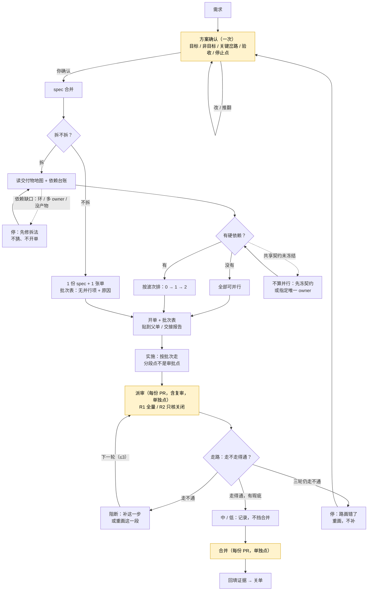

# spec：一份 spec 一条路（流程收敛）

- 日期：2026-11-03
- Issue：待开（spec 合并后）
- 状态：草案（待 DoR / 过闸）
- 决策人：用户
- 决策来源：2026-11-03 对话。用户原话「大道至简」「不喜欢添油加醋的打补丁」「方案出来一定要和用户确认」「派出复审也需要人工确认」「如果三轮都审不过还有 major 或阻断则应该重新梳理闭环性」。
- 结构：**不拆**（推荐；1 份 spec + 1 张执行 issue；理由：所有改动共享同一条主线与同一份 `SKILL.md` 预算，拆开会多份当前真相）。保留阶段：无。
- 基线：`main@a9b7c1c`
- 上游：`references/spec-maturity.md`、`references/gate-details.md`、`references/phase-handoff.md`、`references/split-large-spec.md`、`references/rationale.md`

## 1. 问题：spec 是文档，不是路

现行 spec 是一堆章节：目标、背景、规则、数据、验收分散在各节，审核逐段找矛盾。每轮审核从不同段落采样，必然抓到新的“owner 冲突 / 自相矛盾 / 计数不符”；作者再补一段，副本又多一处。这不是需求错，是承载方式错。

三个样本：

- **#871（本轮）**：一天至少 4 轮完整重审；第 2 轮 0 阻断 / 8 高 / 35 中 / 54 低（97 条），第 3 轮后阻断又回来；审核自己写「根因是模型层重做未回灌契约 / S01 旧副本」。
- **#608（反面）**：29 天写完才写第一行代码；46 条评论、一份 spec 39 次提交；主 spec 810 行、110 个验收框未勾；四波实施 PR 各 30 / 33 / 23+ / 22 条评审发现。
- **#159（正面）**：设计稿先当靶子，spec 期 29 条发现（1 高 / 12 中 / 16 低）在写代码前改掉；实施期只剩 8 条（1 高 / 3 中 / 4 低）；spec 合并到发版 77 分钟。

结论：不是缺账本、缺卡、缺轮次，是 **spec 没有一条能从头走到尾的路**。没有路，审核只能逐段找矛盾；有了路，审核只问“走不走得通”。

现行“骨架版 + 四列对照”已经是路的种子；本 spec 把它扶正为整份 spec 的主线，补一列“失败 / 空态”，删掉后来长出来的旁支。

### 1.1 六个诉求与落点

| 诉求 | 落点 | 验收 |
|---|---|---|
| 1 多阶段不问 | 方案确认一次授权；分段点是步骤，不是审批点 | V04、V08 |
| 2 issue 并行 / 批次 | 一条能独立走通的路 = 一份 spec = 一张单；开单即出批次表 | V07 |
| 3 N 轮阻断、三轮重梳 | 走路审核：R1 全量 / R2 只核关闭 / R3 停 | V05、V06 |
| 4 方案和代码闭环、交互确认、派审确认 | 每步有落点与证据；方案确认看路答 3 句；派审 / 合并单独点 | V03、V04、V06 |
| 5 目标不散、决策过程 | 起点 / 终点是目标；岔口写谁拍 / 日期；汇报第一行复述 | V03、V04 |
| 6 确认再动手 | 没确认路，不写 spec、不动代码 | V04 |

## 2. 调研

| 说法 | 出处 | 对本 spec 的含义 |
|---|---|---|
| SDD 有 spec-first / spec-anchored / spec-as-source 三级；文档一多就重复、漂移；她的判断是：宁愿审代码，也不想审这一堆 markdown | [Böckeler 2025](https://martinfowler.com/articles/exploring-gen-ai/sdd-3-tools.html) | 少写散文，多写一张可走的路；文档副本越多，越难闭环 |
| tasks 用 `[P]` 标可并行，按阶段 / 用户故事分组，带依赖与执行顺序，阶段末 `STOP and VALIDATE` | [GitHub Spec Kit tasks 模板](https://github.com/github/spec-kit/blob/main/templates/tasks-template.md) | 批次表不是新发明：并行标记 + 硬前置 + 阶段校验 |
| agent 需要 human checkpoint、最大迭代次数；evaluator-optimizer 只在判据清晰时有效 | [Anthropic Building effective agents](https://www.anthropic.com/engineering/building-effective-agents) | 派审 / 合并是人工检查点；R3 是最大迭代 |
| 上下文变长会 context rot；结构化笔记与压缩要保留决定 | [Anthropic context engineering](https://www.anthropic.com/engineering/effective-context-engineering-for-ai-agents) | 目标、决定、验收必须在上下文外持久化，不能只靠聊天记忆 |
| 评审标准是“有改进且无阻断就合”，不追求完美；中 / 低标 Nit；僵持就升级 | [Google code review standard](https://google.github.io/eng-practices/review/reviewer/standard.html) | 中 / 低不挡合并；R3 僵持就停，不再加一轮 |

## 3. 目标与非目标

### 目标

- **一份 spec 一条路**：起点、终点、步骤、失败 / 空态、证据；每条规范句挂一个步号。
- **方案确认一次**：目标 / 非目标 / 主路 / 3–5 个关键交互 / 岔路 / 验收 / 批次 / 审核预算 / 停止点；确认后不逐阶段问。
- **走路审核**：R1 全量、R2 只核关闭、R3 停；中 / 低不挡合并；复审重新点卡。
- **开单即出批次表**：一条能独立走通的路 = 一份 spec = 一张单；几条路能同时走 = 批次表。
- **保留判断权与安全阀**：两段流程、worktree 锁、合并确认、审核档位、完成标准不变。

### 非目标

- 不新增决策账本、验收矩阵、状态机、插件、Hook、CI。
- 不迁移旧 spec；旧 spec 只读收尾。
- 不改两段流程、worktree 锁、合并授权、审核档位、完成标准。
- 不提高 `SKILL.md` 预算（4,700 字符）。
- 不把 #608 的业务方案写进本 spec。
- 不自动派审、不自动合并、不把“方案确认”当派审授权。
- 不批量重命名现有 references 中的卡名引用（含历史 spec）；只改用户看到的摆法。

## 4. 机制清单

| # | 机制 | 解决什么 / 没有它会怎样 |
|---|---|---|
| 1 | **一条路**：起点 / 终点 / 步 / 失败 / 证据 | 没有它：spec 是段落堆，审核逐段找矛盾，永远找得完 |
| 2 | **方案确认一次**：一页，含 3 个问题 | 没有它：逐阶段问，或没确认就开干 |
| 3 | **走路审核**：R1 / R2 / R3 | 没有它：N 轮全量扫，阻断反复，用打补丁代替重画 |
| 4 | **派审 / 合并单独点**（含复审） | 没有它：方案确认被当成派审授权，复审自动派出 |
| 5 | **开单批次表**：按路拆、按硬依赖排波次 | 没有它：用户自己猜先后，伪并行，合并时撞车 |
| 6 | **目标锚**：起点 / 终点 / 岔口决定 / 汇报复述 | 没有它：越聊越散，最终拿不准目标 |

> 卡名保留（页面 / 拆分 / 机制 / 例外 / 改旧 spec / 闸 / 修订 / 合并），供现有 references 引用；用户看到的摆法从“逐张卡”改为“方案确认 + 派审 + 合并”三次。

## 5. 详细规则

### 5.1 一条路

**写法**：

- 开头两行：`起点：…`、`终点：…`；各一句，可观察。
- 主表四列：**步 | 触发 → 响应 | 失败 / 空态 | 落点 / 依据 / 证据**。
- 每条规范句必须挂一个步号；挂不上 = 不写。
- 岔口的决定写在步旁：`D01 结论｜谁拍｜日期`；agent 自定标 `自定`。
- 多阶段 = 路的段；分段点是步骤，不是审批点。
- 复杂需求 = 一条主路 + 3–5 条关键岔路；岔路多了 = 该拆单，不是写更长。
- 非目标 = 不走的岔路，写在起点旁。
- 证据必须可执行（命令 / 断言 / 截图）；观察式例外按 `references/done-criteria.md`。
- 大 spec 允许附表；首页只放主路和索引；同一决定只能有一个正文 owner。

**主路与分支**：

黄底 = 人工确认点；实线 = 主路；虚线 = 分支 / 回路。

### 5.2 方案确认

**一页内容**：起点 / 终点；3–5 个关键交互；岔路（D01…）；验收（A01…）；拆 / 不拆与批次；审核预算；停止点。

**只问 3 句**：

1. 起点对不对？
2. 岔路选哪个？
3. 终点是不是你要的？

不设“确认”按钮；答完 3 句才算确认。页面 / 拆分 / 机制 / 例外 / 改旧 spec / 阶段，都在这页里一次呈现，不再逐张摆卡。

- 用户改：改这页，重问 3 句；不新开卡。
- 没确认：不写 spec、不动代码、不开 issue。
- 方案确认不包含派审授权；派审 / 复审仍单独点。

### 5.3 走路审核

| 轮 | 做什么 | 出什么 |
|---|---|---|
| R1 | 从起点走到终点，每步核触发 / 响应 / 失败 / 证据；发现挂步号 | 阻断 / 高 / 中 / 低 |
| R2 | 只核上轮发现是否关闭 + 是否新增阻断 / 高；新中 / 低只记录 | 关闭率 + 新阻断 |
| R3 | 仍有阻断 / 高：停，不再派第 4 轮同款 | 重画 / 砍范围 / 停，三选一由用户拍 |

**严重度**：

- **阻断**：走不通；证据不可执行；同一决定多 owner；岔路未选；数据 / 安全 / 权限问题。
- **高**：会导致返工或跨份不一致，但本轮可修。
- **中 / 低**：不挡合并；记录，排后续。
- 涉及数据丢失 / 安全 / 权限的，一律阻断，不管谁标的中 / 低。

**合并标准**：有改进且无阻断就合，不追求完美（Google）。中 / 低不挡合并；未处理项写进合并卡。

**复审**：每次复审 = 新的一次派发 = 新摆一张派审卡；修订选择只授权修改，不授权再派。

**必问一句**：有没有该走没走的岔路？没有这一问，路只覆盖写出来的，漏掉没想到的。

**发现挂步号**：挂不上的发现只作建议，不升阻断；防止用泛泛的“质量意见”扩大战场。

### 5.4 开单与批次表

- 一条能独立走通的路 = 一份 spec = 一张单；不能独立走通的，先画通再开单。
- 开单报告附批次表：**批次 | issue | 产物 | 前置 | 并行组 | 合入 / 发布**。
- 没有硬依赖：写“全部可并行”；单 issue：写“本批不拆，无并行项 + 原因”。
- 共享契约 / 同一决定：未冻结不算并行；冻结后指定唯一 owner，其余引用。
- 依赖缺口（环 / 多 owner / 没产物）：停，先修拆法，不猜、不开单。
- 表贴到父单 / 交接报告；用户不用自己从地图里推。

### 5.5 执行

- 方案确认覆盖整份 spec 的所有阶段；阶段之间不问“要不要继续”。
- 只在预声明停止点停：**新岔路 / 新决定、生产写、不可逆迁移、外部契约变更、范围变化、闭环破裂**。
- 每份 PR：派审卡 + 合并卡，两次都由用户点；派审卡含复审。
- 波次边界只报进度，不请求续做许可。
- 停止点之外，agent 自己组织开发；不逐阶段问。

### 5.6 与既有规则的关系

**保留**：两段流程（段一 1–6、段二 7–9 编号不动）；判断权（派审 / 合并 / 方案确认）；worktree 锁；合并确认；审核档位；完成标准；拆分规则；ADR 选修；旧 spec 只读收尾。

**改变**：

- 卡片总表从 8 行平铺改为 2 组：**方案确认**（页面 / 拆分 / 机制 / 例外 / 改旧 spec 一次摆完）+ **交付确认**（派审 / 合并；修订并入合并选项）。
- 卡名保留，不批量重命名 references 中的 312 处引用；只改摆法。
- 新增 `references/one-path.md`，承载路模板、写法、审核清单、批次表样例。
- 审核细则进 `gate-details.md`；阶段 / 停止点进 `phase-handoff.md`；按路拆与批次表进 `split-large-spec.md`；骨架版 = 路的第一屏，进 `spec-maturity.md`。

**不新增**：账本、矩阵、状态机、插件、Hook、CI、自动派审、自动合并。

## 6. 改动面

| 文件 | 改动 |
|---|---|
| `SKILL.md` | 主线改为「需求 → 一条路 → 方案确认 → spec 合并 → 开单 / 批次表 → 实施 → 派审 / 合并 → 回填」；第 2–4 步改为路 / 方案确认 / 对照；卡片总表 8 行改 2 组；第 6 步加批次表；第 7–9 步保持编号；参考表加 `one-path.md`；正文 ≤ 4,700 |
| `references/one-path.md`（新） | 路模板、起点 / 终点写法、D/A 挂法、失败列、审核清单、批次表样例、3 句确认 |
| `references/gate-details.md` | 审核改为走路；R1 / R2 / R3；严重度；中 / 低不挡合并；复审重新摆卡；发现挂步号 |
| `references/phase-handoff.md` | 交接区加“阶段 / 停止点”；一次授权覆盖整份 spec；阶段之间不问；派审 / 合并仍单独点 |
| `references/split-large-spec.md` | 按“能独立走通的路”拆；开单即出批次表；共享契约 / 依赖缺口处理 |
| `references/spec-maturity.md` | 骨架版 = 路的第一屏；方案确认 3 句；设计稿 / 样例 = 路的可视 / 可执行靶子 |
| `references/rationale.md` | 新增 R35：一条路、3 轮熔断、派审确认、批次表；记录来源、决定、代价、验证边界 |
| `README.md` / `README.zh-CN.md` | 流程、3 次确认、卡片分组、R1–R35、`one-path.md`；节标记一一对应 |
| `scripts/check-docs.sh` | 不改逻辑；新 reference 自动纳入存在性检查；语义靠人工 |

### 6.1 预算

当前 `SKILL.md` 正文 4,700 / 4,700，余量 0。

- 卡片总表 8 行改 2 组：预计净减约 150–250 字符。
- 主线 / 第 2–4 步 / 第 6 步改写：约 +120。
- 参考表加 `one-path.md`：约 +35。
- “工作区与锁”305 字符移进 `worktree-lock.md`，主文件留一行：约 −250。

预计净增为负；实施时逐节实测，目标仍 ≤ 4,700。若超，按“先压缩措辞、再移细则”的顺序处理，不删承重规则。

### 6.2 文档检查边界

`check-docs.sh` 现行检查：正文 / frontmatter / 整份预算、references 路径与相对链接、README 双语节标记、发布纪律 / 发布闭环、采用契约。它不检查卡片分组、R 范围、语义闭环；这三项在 V02 / V10 人工核对。本 spec 不新增脚本。

## 7. 验收

每条验收在实施 PR / issue 留**输入、期望、实际、证据**；未跑的交互演练标“未验收”。

- **V01** `bash scripts/check-docs.sh` 绿；`SKILL.md` 正文 ≤ 4,700、整份 ≤ 5,200、警示符 ≤ 3。
- **V02** 两份 README 节标记一一对应；正文写“R1–R35”；文件表都点到 `references/one-path.md`；`rationale.md` 末尾确有 R35、R1–R35 连续；卡片总表为 2 组 3 次确认（人工核对）。
- **V03** 用 spec-flow 自己的“开单出批次表”做样例，产出一条路：起点 / 终点各一句；≥4 步；每步有触发 → 响应、失败 / 空态、证据；每条规则挂步号；样例里不出现 #608 的业务词。
- **V04** 方案确认一页含 3–5 个关键交互、岔路、验收、批次、审核预算、停止点；只问 3 句；页面 / 拆分 / 机制 / 例外 / 阶段都在这一页；未确认时无 spec 正文、无代码、无 issue。
- **V05** 模拟 R1 发现阻断 → R2 只核关闭 → R3 仍有阻断：触发“重画 / 砍范围 / 停”三选一，不派第 4 轮；复审重新摆卡；修订选择不自动派审。
- **V06** 中 / 低发现不挡合并；数据 / 安全 / 权限问题无论标什么级别都阻断；合并卡列未处理项。
- **V07** 批次表覆盖五种形态：单 issue（不拆 + 原因）、多 issue 无依赖（全部可并行）、有硬依赖（波次）、共享契约未冻结（不算并行）、依赖缺口（停）；表贴到父单 / 交接报告。
- **V08** 一次方案确认覆盖多阶段；阶段之间不问“要不要继续”；只在六个停止点停；每份 PR 派审 / 合并各点一次。
- **V09** 两段流程、worktree 锁、合并确认、审核档位、完成标准不变；旧 spec 不迁移；段一 1–6、段二 7–9 编号不动。
- **V10** 不新增账本 / 矩阵 / 状态机 / 插件 / Hook / CI；不自动派审 / 自动合并；卡名未批量重命名；未确认方案不动手。

## 8. 自定细节

- **新文件名**：`references/one-path.md`。
- **卡片分组**：方案确认（页面 / 拆分 / 机制 / 例外 / 改旧 spec）+ 交付确认（派审 / 合并）；卡名保留，只改摆法；修订并入合并选项（按建议修 / 只修阻断 / 不修直接合 / 先不合）。
- **3 句确认**：起点对不对 / 岔路选哪个 / 终点是不是你要的。
- **严重度**：阻断 = 走不通 / 证据不可执行 / 多 owner / 岔路未选 / 数据安全权限；高 = 会返工；中低 = 不挡合并。
- **批次表列**：批次 / issue / 产物 / 前置 / 并行组 / 合入发布。
- **停止点**：新岔路 / 新决定、生产写、不可逆迁移、外部契约变更、范围变化、闭环破裂。
- **预算**：卡片表缩减 + “工作区与锁”移入 `worktree-lock.md`；目标 ≤ 4,700，不上调。
- **旧 spec**：不迁移，只读收尾。
- **结构**：不拆；理由见头部。
- **样例**：spec-flow 自己的“开单出批次表”，不用 #608 业务。

## 9. 审核修订记录

| # | 严重度 | 发现 | 处置 |
|---|---|---|---|
| — | — | 待审 | — |
