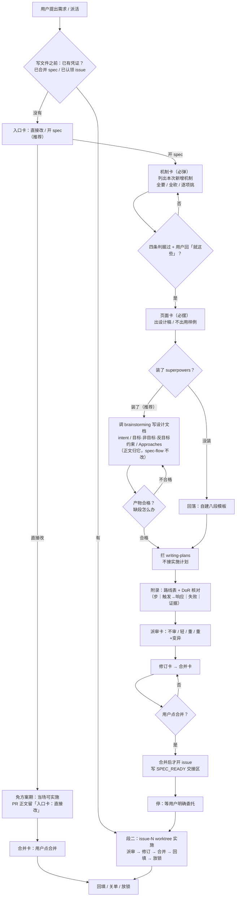

# spec：把 spec 正文交给 brainstorming 生成（草案）

- 日期：2026-11-05
- 状态：**草案**——D11 / D12 两处未决（§5），未过 DoR
- 结构：不拆（1 份 spec + 1 张执行 issue）
- 基线：`main@006bb45`
- 前置：#159（入口卡 / 页面卡必摆）——本 spec 假设它同批或先合入
- 决策人：用户

## 1. 问题：两套规矩各跑各的

三条实测，都是当场跑的：

1. **spec-flow 从没调用过 brainstorming**：`grep -rn "superpowers\|brainstorm" SKILL.md references/ README*.md` → 0 命中。段一那 6 步自己就是生成器。
2. **产物里没有备选**：`grep -l '备选\|方案对比\|alternatives' docs/specs/*.md` → 2 / 29。
3. **全局规矩空转**：`~/.agents/AGENTS.md` 写「superpowers 只用 `brainstorming`，禁用 `writing-plans`」，但这条在 spec-flow 路径上从未生效——spec 一直是 spec-flow 自己生成的。

后果不是"少了个技能"，是**原味只能靠模仿**。brainstorming 的设计文档写死了两段我们没有的东西：Approaches（2–3 种做法、各自代价、选了哪个和为什么）和 anti-goals（什么算失败）。缺了这两段，一个自洽但选错的方案能一路绿灯走到底——派审的三条判据（走不通 / 证据不可执行 / 多 owner）默认路线本身没问题。

## 2. 决策点全表

| # | 决策 | 结论 | 状态 |
|---|---|---|---|
| D01 | 「要不要出 spec」由谁判 | 用户点入口卡，agent 不自判 | 已实施（#159） |
| D02 | 「有没有页面」由谁判 | 页面卡必摆，判据只当推荐理由 | 已实施（#159） |
| D03 | spec 正文由谁生成 | brainstorming；spec-flow 不碰正文 | **待实施** |
| D04 | spec-flow 加什么 | 只加附录：路线表 + DoR 核对 | **待实施** |
| D05 | 附录与正文冲突 | 以正文为准；附录不得引入正文没有的决定 | **待实施** |
| D06 | 小型改动是否也要附录 | 纯文档 / 单文件一行可省 | **待实施** |
| D07 | 卡片顺序 | 机制卡 → 页面卡（机制没定就问设计稿是倒序） | **待实施** |
| D08 | 「机制定了」怎么算 | 四条判据，见 §3.2 | **待实施** |
| D09 | 起点 / 岔路 / 终点三句 | 删除；方向由设计文档和用户点头承担 | **待实施** |
| D10 | ADR 是否默认启用 | 否，保持选修；本仓只写一条一次性 ADR | 已定 |
| D11 | 没装 superpowers 怎么办 | 回落自建八段模板 / 报错停下 / 不提供 | **待定** |
| D12 | 产物缺段怎么办 | 打回重跑 / 我们补写 / 降级模板 | **待定** |

D10 的依据：ADR 记的是跨任务长期决定，一份 spec 一条 ADR 会让 ADR 变成 spec 的镜像，取代链越滚越长；而且默认启用意味着每个接入仓都要建 `docs/decisions/` 和规则页，与"选修默认关闭"的定位冲突。

## 3. 机制清单

### 3.1 四条新机制

| 机制 | 解决什么 | 没有会怎样 |
|---|---|---|
| **M1 委托生成**：段一第 2 步之后调 brainstorming，正文归它 | 原味只能由原作者生成 | 继续用模板模仿，Approaches 永远缺 |
| **M2 附录**：只在文末追加「路线表 + DoR 核对」 | 给派审挂步号、DoR 核对、拆分提供宿主 | 审核退回泛泛意见，验收散在散文里 |
| **M3 拦 writing-plans**：它批准后强制调下一个技能，我们截住 | 不让被禁的技能跑起来 | 流程跑到实施计划，偏离两段 |
| **M4 机制卡前置**：机制卡先于页面卡，关闭条件四条 | 机制没定就问设计稿是倒序 | 机制被砍后设计稿白等 |

### 3.2 机制卡的四条关闭判据

1. 每条机制都写得出「解决什么 / 没有会怎样」——写不出的不进卡。
2. 每条都有处置：要 / 不要 / 并入别的，**没有「待定」**。
3. 没有两条解决同一件事；有依赖的必须一起定。
4. 用户看到最终清单后回一句「就这些」。

前三条由 agent 自查并逐条报告，第四条只能用户给。判据 4 之前，页面卡不弹。

## 4. 改动面（文件级）

| 文件 | 改什么 |
|---|---|
| `SKILL.md` 段一 | 第 2 步后插入「调 brainstorming 写正文」；删三句；机制卡移到页面卡前 |
| `references/one-path.md` | 〈〇〉补 M4 与四条判据；新增〈六〉附录 A 定义（表头、冲突规则、可省条件） |
| `references/spec-maturity.md` | 删掉「先出骨架版」的那段前置，改为「正文由 brainstorming 产出，附录补路线」 |
| `references/phase-handoff.md` | 交接报告加一行「本 spec 正文生成器：brainstorming / 回落模板」 |
| `references/apply-to-project.md` | 指针块加一句「spec 正文由 brainstorming 生成；没装时回落」 |
| `README.md` / `README.zh-CN.md` | 同步，节标记一一对应 |

**预算**：`SKILL.md` 正文 4,696 / 4,700。删三句腾出的字要 ≥ 新增的字，否则先删再加（§7 风险 3）。

## 5. 未决（两处，必须拍板才能过 DoR）

**U1 · 没装 superpowers 的机器怎么办**

| 选项 | 好处 | 代价 |
|---|---|---|
| A 回落自建八段模板（推荐） | 谁都能跑，不装也能出 spec | 模板要我们维护，且它不是原味 |
| B 报错停下 | 原味纯净 | 没装的机器直接不能用 spec-flow |
| C 不提供，要求先装 | 简单 | 把安装成本推给每个接入仓 |

**U2 · brainstorming 产物缺 Approaches 怎么办**

| 选项 | 好处 | 代价 |
|---|---|---|
| A 打回重跑（推荐） | 原味不打折 | 多一轮生成 |
| B spec-flow 补写缺的段 | 快 | 补写就是我们在改它的产物，原味破了 |
| C 降级走自建模板 | 有兜底 | 这份 spec 放弃原味 |

## 6. 目标流程

## 7. 风险

1. **依赖外部 skill 行为**：brainstorming 改产物契约，我们接不住。缓解：附录必须能从正文推出，删掉附录 spec 仍可读。
2. **两套审核重叠**：brainstorming 自带 builder check（派子 agent）+ HARD GATE，我们的派审卡是另一套。**明确：builder check 不是我们的审核档位，不重复派；它跑它的，我们只认派审卡。**
3. **预算**：`SKILL.md` 只剩 4 字余量，任何新增必须同时给删除项。
4. **拦截靠规矩不靠机制**：writing-plans 的拦截是文字约束，不是钩子；跨 harness 无强制。

## 8. 自定细节（留给实施者）

- 附录标题固定：`## 附录 A · 路线表（spec-flow 加，不改上文）`。
- DoR 核对写成勾选表，每行指回路线表步号；不另造第三份表。
- 段一第 3 步措辞由「点头后才动 spec」改为「点头后才调 brainstorming」。
- 交接区的「本 spec 正文生成器」字段取值只有两个：`brainstorming` / `回落模板`。

## 9. 验收

- [ ] 一次真实需求全链路：入口卡 → 机制卡（四条判据）→ 页面卡 → brainstorming 生成 → 附录 → 派审，每步留证。
- [ ] 未装 superpowers 的临时环境：按 U1 结论走通一次。
- [ ] 缺段演练：按 U2 结论执行一次，记录产物差在哪几段。
- [ ] `bash scripts/check-docs.sh` 绿；`SKILL.md` 正文 ≤ 4,700。
- [ ] 附录与正文冲突演练一次：确认执行时以正文为准。

## 附录 A · 路线表（spec-flow 加，不改上文）

| 步 | 触发 → 响应 | 失败 / 空态 | 落点 · 依据 · 证据 |
|---|---|---|---|
| 1 | 用户提需求 → 摆入口卡 | 没点 → 停，不动笔 | #159 的卡片定义 |
| 2 | 点「开 spec」→ 摆机制卡 | 有机制写不出「没有会怎样」→ 不进卡 | §3.2 判据 1 |
| 3 | 机制全有处置 → 复述清单请用户确认 | 有「待定」→ 卡不关 | §3.2 判据 2、4 |
| 4 | 用户回「就这些」→ 摆页面卡 | 没答 → 停 | `one-path.md`〈五〉 |
| 5 | 页面卡答完 → 判有没有 superpowers | 没装 → 按 U1 走 | §5 U1 |
| 6 | 装了 → 调 brainstorming 生成正文 | 产物缺段 → 按 U2 走 | §5 U2 |
| 7 | 正文生成完 → 拦 writing-plans | — | 本节 §3.1 M3 |
| 8 | 追加附录：路线表 + DoR 核对 | 附录与正文冲突 → 以正文为准 | §7 风险 1；D05 |
| 9 | 附录成形 → 摆派审卡 | 未点档 → 不派 | `gate-details.md` |
| 10 | 合并 → 开 issue + `SPEC_READY` | spec 未合并 → 不开单 | `phase-handoff.md` |
