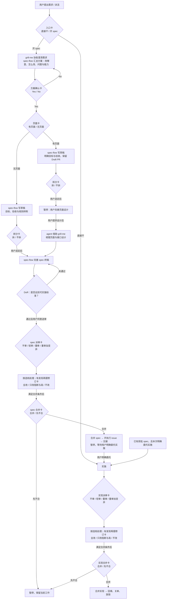

# spec：grill-me 辅助需求梳理，spec-flow 负责规格与交付（V2）

- 日期：2026-11-05；修订：2026-11-09。
- 状态：**V2 流程与局部覆盖边界已获用户确认；进入审核选档，未实施**。
- 结构：沿用本 PR 的不拆选择，1 份 spec、合并后开 1 张执行 issue；本轮不开执行单。
- 基线：`main@006bb45`。
- 需求承接：#159 的入口决策与页面确认诉求转交 #161，按本 spec 的 V2 统一实施；#159 是需求来源，不再要求先合并。
- 流程依据：[用户确认的 V2 评论](https://github.com/nano-sun99/spec-flow/pull/160#issuecomment-6720060856)。
- 决策依据：同 PR 的一次性记录 `docs/decisions/2026-11-05-delegate-spec-generation.md`；不代表本仓采用 ADR 制度。

## 1. 目标与边界

**目标**：spec-flow 保持流程工具的职责，引入 grill-me 补足专业需求澄清；用户用同一张可理解的方案确认卡作决定，spec-flow 把已确认需求写成可实施、可验收的规格，并守住必要闸口。

- grill-me 辅助查清需求、比较真实选择、找遗漏；不是等需求全部定完后才加载的写稿工具。
- V2 仅局部替换方案期的澄清与规格编写，不替换项目总入口、既有任务接手或交付制度。spec-flow 负责汇总、同一份 spec、拆分与审核交接；正文、路线表和验收只有同一套结论。
- 精简的是重复说明与外围分支，不是用户决定权；有页面必须经过用户设计、agent 分析页面及接口，再形成终稿。
- 非目标：本 PR 不实现规则、不安装技能、不默认启用 ADR；不新增台账、运行时状态、兜底模板或检查框架。

## 2. 已确认的 V2 主流程

以下图与 V2 评论一致。前置安装、条件性确认不铺进主图；不以正文补充为由改变图中的授权顺序。

## 3. 各节点的执行约定

### 前置：只检查与授权，不扩成另一套流程

加载 spec-flow 时只读检查 grill-me 及其实际调用的 grilling 是否可加载，不能只看入口目录存在。依赖仅约束 PLAN / ANALYZE 等实际需要专业梳理的方案路径：需使用而缺失时说明安装内容，弹 Yes / No 安装卡；Yes 后才补齐并验证，No 或失败则暂停该路径，不静默换用工具或模板。直接干、既有任务实施及交付不因缺少该梳理技能而阻断，也不为这些路径额外弹安装卡。本轮修订不执行安装。

本轮核对的本机 grill-me 入口仅调用 `grilling`，因此两个技能的调用关系都须验证。安装授权不等于方案确认、派审、合并或实施授权；这些前置说明不增加 V2 主图节点。

### ENTRY / APPROVED：沿用项目入口，V2 不覆盖已有任务

- 先沿用 `SKILL.md` 的开工入口与 `references/phase-handoff.md` 的接手规则：已有 issue 按有效委托进入实施期，未合并 spec / PR 按当前阶段接续，已有有效确认沿用、不重开。
- 仅新需求在写文件前给出“直接干 / 开 spec”，不因 agent 判断改动小就替用户选；PR 正文保留入口选择。
- “直接干”只免方案期，仍走实现的派审、修订、合并卡；不为它强行补一份 spec 或新开执行单。
- 已有获批（已合并）spec 且本次明确委托实施，按既有认领与 worktree 规则接续，不重走需求访谈。授权覆盖同一份 spec 的既定范围，阶段之间不重复问；只有已合并 spec、已认领 issue 或范围外的历史授权本身，不代表本次可以自动实施。

### PLAN / CONFIRM：只保留一个方案汇总与确认循环

- 用户选择开 spec 后立即加载 grill-me。事实先由 agent 查，目标、范围、真实备选的代价、失败条件等由它协助澄清；只问用户才能决定的问题，逐题给推荐，不把所有可能分支一次倒给用户。
- spec-flow 统一汇总“改哪里 / 怎么改 / 解决什么问题或带来什么能力”，并明确目标、范围、验收标准；真实备选不存在时说明理由，不凑选项。
- 用户只对这份汇总点 Yes / No。No 回到同一个 PLAN，保留上下文、只调整变化部分，直到确认或用户主动停止；首次 Yes 前不写 spec。
- 不再单摆机制卡、要求额外回复“就这些”，也不在后面重复生成一份“澄清结果汇总”。原需交代的新做法和理由写在这同一份方案里；原固定的起点 / 岔路 / 终点三句不再另作闸口。
- 后续若改变已确认的目标、范围或能力，仍回到这同一个确认循环；补齐已有决定不重复问。方案 Yes 不等于送审、合并或实施授权。

### PAGE / 草稿 / 拆分：方案 Yes 后立即分路

- PAGE 紧接 CONFIRM 的 Yes。agent 可解释与推荐，但由用户选择有页面 / 无页面；未选择不进入后续路径。页面指可交互 GUI，CLI 输出等沿用现行无页面定义。
- 无页面：spec-flow 写目标、验收和规则样例；按 `references/spec-maturity.md` 既有要求，用正常、边界 / 异常、失败或重跑样例把输入输出说清，再完善终稿。
- 有页面：先写目标、验收、范围和设计需求草稿，保留同一个 Draft PR；不能在拿到页面设计之前把完整页面需求和接口契约猜成终稿。
- 两路都在草稿形成后按 `references/split-large-spec.md` 单独摆拆分卡。`NO_SPLIT` 与 `UI_SPLIT` 互斥，一次只走所选分支；未选不向后推进，结构未变不重复确认。

### DESIGN / ANALYZE：用户做设计，agent 梳理页面与接口

用户自行完善并提供页面设计；等待期间暂停，不代画、不自动转为无页面。用户明确改变页面范围时，回到同一方案确认循环。

设计到位后，agent 借助 grill-me 对照目标和验收，逐页梳理交互、状态、数据、异常和权限，并核对所需接口是复用、修改还是新增，写清请求、响应、错误与读写关系。缺页、关键冲突或未确认的接口口径交用户补齐 / 决定，不能靠猜补完。

已提供且仍覆盖当前范围的设计继续复用，不要求重复交稿。分析结果写回同一份 spec；实质方案变化回 CONFIRM，不新增第二种方案卡。

### FINAL / DOR：spec-flow 负责完整规格

- spec-flow 将已确认决定、样例或页面 / 接口对照、路线及可执行验收写进同一份终稿，自定细节按既有规则列末尾；不划分“外部正文不可改 / 本体只能加附录”两个所有者。
- DoR 沿用 `references/spec-maturity.md`：承重决定无待定，步骤与失败结果明确，写路径与读侧清楚，验收可执行；迁移、兼容、外部影响等不适用时说明原因。检查未通过就补稿，不借补稿扩大方案。
- 通过 DoR 且用户同意送审后才转 Ready、摆派审卡。V2 确认仅确认流程，不自动批准这份修订稿、审核或合并。

### 派审 / 修订 / 合并 / HANDOFF：每份交付独立过闸

完整沿用 `references/gate-details.md` 与 `references/phase-handoff.md`，不新增档位、自动派审或合并权限：

- spec 与实现分别选“不审 / 轻审 / 重审 / 重审加变异”；不审执行自查。有发现才摆“全改 / 只改阻断与高 / 不改”，复审须重新选档。
- 无未处理阻断 / 高且满足验证条件后，单独摆合并卡。先不合就暂停；修订选择、检查通过、上一阶段的档位都不能代替本份合并授权。
- spec 合并后才开执行 issue，写 `SPEC_READY` 和批次表，再停下来等本次明确实施委托；不自动开始实施。实现合并后按既有规则回填、关单、放锁。
- 例外、改已合并 spec 等条件性确认仍按既有规则触发，不因主图精简而删除，也不改成每次必问。

## 4. 方案改动清单（兼作现行审核所需的机制清单）

以下仅对照已获确认的 V2，不另建确认卡或第二份方案。

| 已确认改动 | 解决什么 | 没有会怎样 |
|---|---|---|
| PLAN：grill-me 专业澄清，spec-flow 负责规格与流程 | 梳理能力与交付职责分开 | 外部工具只剩写稿，或接管本体流程 |
| CONFIRM：用户可读汇总与同一个 Yes / No 循环 | 让用户确认实际改动与收益 | 内部术语取代用户决定，汇总重复 |
| PAGE → DESIGN → ANALYZE：设计后二次梳理页面及接口 | 把真实设计落实为需求与契约 | 只有等设计，没有分析设计这一环 |

## 5. 实施改动面

本 PR 只修改本 spec 和一次性决策记录；下表是后续执行 issue 的范围，不在这次顺手实现。

| 文件 | 按 V2 同步的内容 |
|---|---|
| `SKILL.md` | 将 PLAN / CONFIRM、PAGE 两路接入原方案期；梳理依赖仅约束所需路径，不改原入口、接手与交付授权 |
| `references/one-path.md` | 用同一方案汇总和确认循环替代机制卡 / 固定三句，保留条件性卡与必要闸口 |
| `references/spec-maturity.md` | 明确先草稿、后用户页面设计、再分析页面与接口、终稿及 DoR |
| `references/split-large-spec.md` | 对齐两路草稿后拆分的入口，避免重复确认；不重设拆分判据 |
| `references/gate-details.md` | 原机制清单的核对定位指向同一方案说明；档位、修订、复审、合并权限不变 |
| `references/phase-handoff.md` | 沿用合并后开单与明确授权，不要求无意义改动；不添加“正文生成器 / 回落模板”字段 |
| `references/apply-to-project.md` | 说明仅方案梳理需要的依赖与安装授权，不阻塞原实施路径，不自动改本机或其他仓 |
| `references/rationale.md` | 为本次规则变更追加依据，旧决定只标取代，不批量改写历史 |
| `README.md` / `README.zh-CN.md` | 同步职责、依赖和主线；保留双语节标记及引用对应 |

实施时重新量预算，`SKILL.md` 正文仍须 ≤ 4,700 字符；不能把完整外部技能复制进本体，也不能扩大预算。结构或改动范围实质变化时按既有规则重新确认。

## 6. 验收标准

以下是**后续实施**的完成条件，均未在本次规格修订中冒充已通过。用固定输入、操作记录与产物断言留证，不用无限期观察代替验收。

- [ ] A1（ENTRY / APPROVED）：分别演练新需求、直接干、接续未合并 spec / PR、明确委托既有 issue（含无交接区旧单）及已合并 spec。仅新需求出现入口卡；已有任务按原阶段 / 有效委托接续，确认不重问、稿件不重开；直接干仍走实现交付闸。保存交互记录与 PR 正文。
- [ ] A2（PLAN / CONFIRM）：同一需求先选 No、补充反馈、再选 Yes。No 后没有新 spec，反馈进入同一份方案；Yes 后立即出现 PAGE。记录包含改哪里、怎么改、问题 / 能力、目标与可执行验收；不得重复摆机制卡或另造澄清汇总。
- [ ] A3（PAGE / NO_SPLIT）：无页面输入配正常、边界 / 异常、失败或重跑样例；草稿后只有一次拆分选择，未选不推进，终稿可据样例判对错，无等待设计步骤。
- [ ] A4（UI_DRAFT / UI_SPLIT / DESIGN / ANALYZE）：有页面输入先得到目标与验收草稿、拆分卡及 Draft PR，然后暂停；用户提供设计后才分析页面和接口。抽取至少一条页面行为核对请求 / 响应 / 错误及权限，再检查结果进入同一份终稿。补充反馈不要求重复提交仍有效的设计。
- [ ] A5（DOR）：提供一份承重决定未定或验收不可执行的稿件，不能送审；按原决定补齐后仍须用户同意送审，不能因 V2 已确认而自动转 Ready。
- [ ] A6（两段交付闸 / HANDOFF）：分别演练不审、选档派审、有发现修订、先不合及明确合并；未选不派审核 agent，阻断 / 高未清不合并，spec 合并前不开执行单，交接后没有明确委托不实施，实施阶段重新选档。
- [ ] A7（前置）：在入口有而 grilling 缺失、两个都可加载的环境分别进入方案梳理。缺失时安装 No 不安装且暂停该路径，Yes 仅补齐获准内容并验证；已有依赖不重复安装。同一缺依赖环境中，直接干 / 已授权旧任务实施不弹安装卡、不被阻断；不加载 superpowers、不恢复模板或专门拦截。
- [ ] A8（同步）：在实施 worktree 运行 `bash scripts/check-docs.sh` 与 `git diff --check` 均通过；检查本 spec、规则、README 双语和交接没有互相冲突的职责、旧卡片顺序或旧生成器字段；历史段落只标已被取代。

## 7. 修订与待确认状态

- 原稿“正文交给 brainstorming、本体只加附录、机制卡四条关闭判据、拦 writing-plans、回落模板及缺段二选项”已被 V2 取代，不再作为待决方案或实施要求；删除专门拦截步骤不等于新增实施计划阶段。
- #159 的上述诉求由 #161 承接，不再作为独立合入前置；V2 流程及 A1–A8 验收保持不变，入口与页面沿用 A1–A4 核对。本稿没有新的业务岔路待定。用户已同意核对局部覆盖边界后进入审核选档；审核档位与合并仍须分别选择，本稿不替用户放行。
- 数据迁移、接口兼容和回滚：本次改的是技能流程，没有业务数据 / API 迁移；未完成的旧 spec 不自动重写，按本次用户委托范围修订；回滚后续规则变更走正常 PR 与合并确认。
- 风险限于外部技能调用关系变化、旧规则落点未同步；分别由前置检查和 A8 核对，不为此新增兜底流程。文档检查通过不代表 A1–A7 的行为演练已通过。

## 8. 自定细节

- 保留现有 spec 与一次性记录的文件路径，避免改名打断已有 PR 引用；标题、正文、PR 说明同步更新。
- 本稿节点名直接复用用户确认的 V2，作为规则与验收的定位依据；不再添加重复路线附录或“正文生成器”字段。
- 本次只修订既有两份文档；不合并 #159、不安装技能、不新增执行 issue、不实施或自动合并规则。
