# spec-flow 整体重构：两段主线，闸口严格，内部灵活

- 状态：整体重写后的规格草稿，待用户审阅；PR 保持 Draft，不合并、不开执行 issue
- 日期：2026-11-09
- 页面 / 结构：沿用本稿已确认的无页面、不拆；1 份规格、1 批整体交付，不重复询问
- 本次授权：用户认可职责重组、选项交互与两段流程，允许重写规格；不等于已授权修改执行规则或实施
- 流程基线：[定稿 Mermaid 评论](https://github.com/nano-sun99/spec-flow/pull/164#issuecomment-6734173401)
- 设计依据：[已确认方向的架构梳理](https://github.com/nano-sun99/spec-flow/pull/164#issuecomment-6734236467)；本项目未采用 ADR，不新增 ADR 制度

起点：用户描述需求，或明确委托一个既有任务。
终点：用户通过两段清晰的流程取得约定交付；必要闸口不被越过，闸内工作方法不被无关模板锁死；采用三层发布时，候选与成功版本包含对应 spec、实现和文档。

## 1. 目标与非目标

**对用户仍是两段，不新增第三套管理流程。**

- **方案期**：把目标、范围和验收定清楚，形成获批规格，再交接执行任务。
- **实施期**：按明确委托实现、验证和交付；需要发布时完成相应发布，不把代码合并当成所有任务都已完成。
- **交互**：闸口和确需用户回答的问题采用选项交互；推荐项解释理由和代价，保留补充入口。事实能查清就先查，不制造不必要的问题。
- **严格的是边界**：用户决定、授权对象、阶段退出条件、交付完整性和真实验证结果。
- **灵活的是方法**：提问次序、方案探索、内部组织、表达格式、实现与验证方法；用户回答 No 后可重新构思，不限于局部修补。
- **原始发布目标保留**：普通文档与需求同走 `dev → staging`，分拣时 spec、代码/必要测试和配套文档不能遗漏。

不做新执行引擎、配置语言、审批平台、CI/Hook 或授权服务；不重做 ADR/标签制度、生产操作手册与版本命名；不自动修改采用项目。这里的“卡死”是明确且可核验的行为规范，不宣称纯 Markdown 能提供平台权限隔离。

## 2. 结构不是再加一层，而是重新归位

以下是**运行规则的唯一正文归属**。规格和定稿评论是设计记录，实施后不作为第二套持续维护的执行正文。

| 职责与落点 | 重构后负责什么 | 移走或删除什么 |
|---|---|---|
| 入口 `SKILL.md` | 识别新需求/既有任务/项目接入，导航当前阶段和已采用模块，指向相应正文 | 重复的完整流程、卡片细则、模板和发布操作；不为重构放宽现有正文预算 |
| 流程 `references/one-path.md` | 定稿 Mermaid、两段主线、阶段事实与衔接、当前下一步；接收 phase-handoff 中重复的状态模型/迁移正文 | 审核档位细则、授权识别判据、硬性写作模板；不在多个文件重复定义同一顺序 |
| 闸口 `references/gate-details.md` | 卡片选项、谁决定、批准对象、放行条件、未答处理、批准不再覆盖的条件；规格可实施/送审等判断归此 | 内部思考步骤、固定提问顺序、任意格式或样例数量要求 |
| 交付 `references/phase-handoff.md` | spec/issue/PR/候选的必要信息，更新责任、授权记录字段与可追溯来源；见 §5 | 状态转移正文归流程，权限判据归闸口；不再把固定报告口吻混成批准条件 |
| 完成 `references/done-criteria.md` | 有限承诺、必要证据、关单与已批准例外的唯一完成判据 | 入口及其他正文只引用，不复制第二份完成定义 |
| 指南 `spec-maturity.md`、`split-large-spec.md`、`spec-revision-sync.md` | 对照设计、分析样例、判断拆分、同步修订的推荐方法 | 原位置的流程顺序、审批条件、重复完成判据迁往对应 owner；不能只换语气而遗失边界 |
| Git 分支流程与发布选修 `references/release-discipline.md` | 只在显式采用时定义分支形态、任务起点、PR 目标、候选挑选，以及批次发布判断和版本快照，见 §6 | 文档专属热修/标签收尾路径，以及与流程/交付 owner 重复的通用正文 |
| 接入 `references/apply-to-project.md` | 采用意图、中央指针、项目实际落点与形态映射 | 不复制整套实施/发布操作，不借本次重构自动升级真实项目 |

其他规则只做受影响的引用同步：工作区/锁及已明确安全边界保留；ADR、文档生命周期、issue 状态/类型仍由原模块负责；`rationale.md` 保存历史依据，不产生第二套可执行规则。

## 3. 闸口与交互契约

### 3.1 闸口如何写清楚

每个闸口只回答：**正在决定什么、对象与范围是什么、谁决定、需要哪些事实、怎样放行、未满足时停在哪里**。具体判据集中在 gate-details，不再靠多个文件相互补充。

| 闸口组 | 必须守住的条件 | 不据此锁死什么 |
|---|---|---|
| 入口与方案 | 用户选择直接干/开 spec；方案获确认后才推进相应规格路径；改变已批准目标/范围要重新确认 | 未确认时怎样探索、是否重新比较或推翻原方案 |
| 页面、公共缺口、拆分 | 公共骨架/Draft 前置；两支汇合后检查待用户决定的缺口，再统一选择拆分 | 怎样分析设计或接口、采用何种对照材料；无页面也可有接口/业务缺口 |
| 送审、审核、修订、合并 | 达到可实施条件且获同意才送审；每份档位和修订按用户选择，合并独立确认 | 合法的规格表达、内部验证顺序；建议不能因未照示例做就升格为阻断 |
| 实施与生产 | 委托对象/范围明确；规格合并不代替实施委托，标签/审核不代替生产批准 | 已授权范围内怎样组织实现，不逐内部阶段索取续做许可 |
| 交付与完成 | 预期、来源、证据和候选内容可核；缺失/未知/失败不写成完成 | 不强迫逐文件抄写 PR diff，也不另建交付账 |

保留现有审核档位、修订选择、轮次限制、独立合并确认与明确授权识别条件，不借结构搬家静默放宽。未答只执行该闸口原已明确的安全默认，不能从沉默扩大授权；实施、合并、生产等授权不能相互代替。

### 3.2 用户交互采用选项，不把它变成问卷

- 有选项工具时用选项卡；问题说明当前决定、推荐和主要代价，给少量真实选项并允许补充。无法穷举的资料可用补充输入，不能捏造假选项。
- 没有选项工具的客户端列出等价选项，等待明确选择；不把缺少工具当成已获得同意。
- 卡片是 agent 发问的方式，不抹掉用户自发给出的明确指令；已有有效确认不因调整方法或挪动节点而重复询问。
- 先查事实，只问用户才能决定或必须由用户提供的内容；不为“走齐流程”凭空增加问题。
- 用户回答 No 时允许继续探索、重组方案；再次得到相关确认后推进，不限制为“只能修改反馈提及部分”。

### 3.3 指南的效力

固定四列表、固定样例数量、固定岔路数量、逐字复述起终点等改为方法建议。严格保留的是需要可判定的路径、必要接口与验收证据，不是示例的字面形式。用户或项目明确约定格式时，以该具体约定为准。

审核仍检查是否违反已批准约定、缺少必要交付或存在真实阻断，不因使用不同但有效的方法判违规。文案、同步或操作表达的瑕疵优先修对齐；扩展建议不自动变成新增常驻机制，也不新增审核档位/修订卡。

## 4. 两段流程与定稿图

方案期：澄清并确认 → 公共骨架/Draft → 页面或无页面分析 → 公共缺口确认 → 统一拆分 → 细化终稿 → 送审/合并 → 交接。

实施期：明确委托 → 实现和验证 → 审核/合并 → 交付回填；采用 Git 分支流程与发布选修的项目继续候选分拣和必要发布。既有状态名优先保留，只由 one-path 定义；不能仅因实现 PR 合并就把尚缺部署或候选交付的任务写成已完成。

`grill-me` 的职责保留：开 spec 后辅助目标/范围/备选/验收澄清；有页面且用户完善设计后，结合设计与骨架分析行为、接口、异常和权限。具体提问方法灵活；无页面不强行安排页面设计分析。工具依赖的原有边界不借机放宽，也不冒充已运行技能。

```mermaid
flowchart TD
    START["用户描述需求"] --> ENTRY{"本次选择哪条入口？"}
    ENTRY -- "开 spec" --> GRILL_PLAN["grill-me：需求澄清<br/>先查事实，厘清目标、边界、备选代价与失败条件<br/>只问用户才能定的事，并给推荐"]
    GRILL_PLAN --> PLAN["spec-flow 汇总同一份方案<br/>改哪里、怎么改、目标范围与验收"]
    PLAN --> CONFIRM{"用户确认方案？"}
    CONFIRM -- "否：继续探索和完善方案" --> GRILL_PLAN
    CONFIRM -- "是" --> DRAFT["写 spec 骨架<br/>开同一份 Draft PR"]
    DRAFT --> PAGE{"是否需要页面设计？"}

    PAGE -- "是" --> DESIGN["用户完善并提供页面设计<br/>期间等待，不猜终稿"]
    DESIGN --> GRILL_ANALYZE["grill-me：结合页面设计与 spec 骨架解析<br/>对照交互、状态、数据、异常与权限<br/>逐项明确接口请求、响应、错误与读写"]
    PAGE -- "否" --> EXAMPLE["结合 spec 骨架分析规则与接口<br/>用正常、边界和失败或重跑样例对照"]

    GRILL_ANALYZE --> GAPS{"是否还有待用户确定的缺口？<br/>设计、接口、业务规则或验收"}
    EXAMPLE --> GAPS
    GAPS -- "有" --> USER_FILL["用户补齐信息或确认口径<br/>有页面时同步完善对应设计"]
    USER_FILL --> RECHECK["结合补充信息<br/>更新同一骨架与对照解析"]
    RECHECK --> GAPS
    GAPS -- "没有" --> SPLIT["用户统一选择拆或不拆"]
    SPLIT --> REFINE["按所选结构优化细化 spec<br/>补足业务规则、接口、数据、异常与验收"]

    REFINE --> SPEC_READY["终稿达到可实施标准<br/>用户同意送审"]
    SPEC_READY --> SREVIEW["用户选择本份审核档位<br/>按选择审核和修订"]
    SREVIEW --> SMERGE["用户单独确认合并<br/>方案 PR 合入 dev"]
    SMERGE --> ISSUE["创建执行 issue<br/>记录获批 spec 与版本、方案 PR<br/>预期成果、测试、文档落点、必要依赖"]
    ISSUE --> AUTHORIZE["用户明确委托实施"]
    AUTHORIZE --> WORK["在任务工作区实施<br/>完成代码、必要测试与配套文档"]
    ENTRY -- "直接干" --> DIRECT["原任务 PR 写清交付范围<br/>不补造 spec 或执行 issue"]
    DIRECT --> WORK
    WORK --> TEST{"本次检查与测试通过？"}
    TEST -- "否" --> WORK
    TEST -- "是" --> IREVIEW["用户选择本份实施审核档位<br/>按选择审核和修订"]
    IREVIEW --> IMERGE["用户单独确认合并<br/>实现 PR 合入 dev"]
    IMERGE --> RECORD["回填原 issue 或任务 PR<br/>全部实现 PR、合入提交<br/>文档实际位置及通过证据"]
    RECORD --> ACCEPT["完成任务所需验收<br/>需测试环境的先验测试环境"]
    ACCEPT --> READY{"当前任务与必要依赖已就绪？"}
    READY -- "否" --> FIX["补齐当前任务交付或验收"]
    FIX --> WORK
    READY -- "是" --> READ["分拣者读取预期与全部来源<br/>对应 spec、实现与测试<br/>配套文档、必要依赖及证据"]
    READ --> SOURCES{"记录齐全且来源可核？"}
    SOURCES -- "否" --> FILL["补原记录或缺失交付<br/>不靠猜测标成完整"]
    FILL --> READ
    SOURCES -- "是" --> PICK["从 dev 按本任务挑入候选<br/>不整段合 dev<br/>已有内容只核验，不重复挑"]
    PICK --> COMPLETE{"当前候选的四类交付物齐全？"}
    COMPLETE -- "否" --> FILL
    COMPLETE -- "是" --> PREVIEW["挑选 PR 按原规则审核和修订<br/>用户单独确认合并"]
    PREVIEW --> STAGING["合入 staging 并回填<br/>挑选 PR、结果提交<br/>四类交付物的核对结论"]
    STAGING -. "无部署义务且验收完成" .-> DOCEND["任务可完成<br/>内容保留在 staging<br/>随下次正常版本留快照"]
    STAGING --> BATCH["选择正常发布批次<br/>核范围、依赖与实际候选补丁"]
    BATCH --> APPROVE["用户明确批准本批发布"]
    APPROVE --> TAG["固定候选完整提交<br/>创建或核对不可变 tag"]
    TAG --> BUILD["从该 tag 构建<br/>记录实际产物并核部署端身份"]
    BUILD --> DEPLOY["按原流程部署与验证"]
    DEPLOY --> SUCCESS{"验证达到本批成功要求？"}
    SUCCESS -- "否" --> FAIL["按既有失败流程处理<br/>不推进 master 成功快照"]
    SUCCESS -- "是" --> SNAPSHOT["master 记录同一 tag 的成功快照<br/>spec、代码与文档一起保留"]
    SNAPSHOT --> CLOSE["回填本次发布结果<br/>按原完成标准分拣并关单"]
```

图固定阶段和闸口，不将节点中“用哪些样例”等说明升格为不可替换的方法。所有 agent 发起的关键选择按 §3.2 交互；直接干路径不补造规格或执行单，但不绕过实施交付与合并授权。

## 5. 交付契约：issue 要写什么，分拣要找什么

信息留在原 issue 交接/交付区；原字段已能承载的复用，不建立第二份台账。确实没有 issue 的直接干任务由原 PR 承接适用信息。

| 信息组 | 需要记录什么 | 谁在何时维护 |
|---|---|---|
| 获批依据 | spec 仓内路径、获批版本完整提交、方案 PR；批准修订明确适用版本 | 方案作者开单时填，复用原 Spec/Spec 合并 commit/方案 PR 字段 |
| 预期交付 | 本任务实现成果/模块、必要测试入口、配套文档明确落点，以及所需共享约定 | 开单从获批 spec 提取，实施确定真实落点后同步；不能由分拣者猜 |
| 实际来源 | 全部相关实现/补充 PR 和各自合入提交；配套文档实际位置，含改名/归档 | 实施者每次相关 PR 合入时回填，不只留最后一个 PR |
| 必要依赖 | 进入候选/发布所需 issue、共享 spec/契约、版本及具体就绪依据 | 沿用 spec 依赖，实施回填实际满足情况；无则写无及原因 |
| 就绪证据 | 通过的测试/验收结果链接及本任务是否仍有部署义务 | 实施者验收后填；只有测试命令没有通过结果不算 |
| 候选结果 | 挑选 PR、合入 staging 的完整结果提交；spec、实现/测试、配套文档、依赖分别记本次纳入/已在核验/不适用及原因 | 分拣者核实际候选并合入后回填；缺失不能写已完成 |

分拣依据是**预期交付与实际来源的对照**，不是仅从已发生的 diff 推断什么都做完了：

- 先读获批 spec 与预期成果/文档落点，再查方案 PR 与全部实现 PR 的实际改动，连同必要已就绪依赖挑入候选。
- 当前候选内核四类结果；已存在的获批内容不重复提交，spec 已归档则核真实路径和正文，不只带原路径删除。
- 共享文件按本任务相关内容协调，不整体覆盖为移动 dev 的最新版，不夹带其他未就绪 issue。
- 缺记录先补原记录，缺交付先补交付并按原要求验证；发布前再核本批当前内容，不能凭曾经合入就认定仍在。

不要求手抄 PR 的每个代码文件；但预期文档、成果和测试入口不能因实际 PR 没出现就默认为不需要。没有 spec/代码/配套文档的项目记无及原因，不补造产物。

## 6. Git 分支流程与发布选修：分清职责，仍按需采用

本模块包含两部分：**Git 分支流程**管任务从哪里开分支、PR 合到哪里、如何按任务完整挑入候选；**发布流程**管候选何时固定版本、经批准构建部署，以及成功后如何留快照。两者衔接，但分支合入不等于已经发版。

这里只准确表达本轮已有范围，不新增独立 Git 选修、第二套采用开关或一套新流程；仍复用现有 `release` 接入入口。

- `release` 默认关闭；采用时明确单主线或三层形态及实际分支映射。上述全图的 dev/staging/master 部分只对三层形态生效，不自动给小项目增加分支或发布义务。
- 三层的普通文档和需求均从 dev 按任务进入 staging；功能分支起点与 PR 目标引用已选形态，不能与通用 main/master 起点并存冲突。
- 无部署义务的普通文档，在所需分支交付和验收完成后可结束，内容留在 staging 随下次正常发布进入 tag/master；不为它另建文档热修、标签决定或服务部署。
- 代码暂不发不等于无需部署；文档站点、生成输入或运行配置按实际影响处理，不按后缀豁免。
- 同一固定候选 tag 保留本批 spec、代码与文档；构建/部署按原授权，成功后才留下 master 快照。标签不证明已部署，master 不代表各服务实时同版。
- 上线后才产生的结果与台账照常进 dev，不能倒灌已固定 tag；发布记录载体、命名和真实热修/恢复操作不在本轮另行重设计。

## 7. 整体交付范围与兼容

这是一批相互配合的规则归位，不拆成多个各自生效的补丁，不另写实施计划：

- 按 §2 的 owner 分工替换相应正文：原位置删除重复规则或保留短指针，不能新旧两套并行。
- `README.md` 与 `README.zh-CN.md` 同批反映两段主线、职责边界及选修入口；保持既有双语节标记和引用完整。
- `rationale.md` 新 R 号记录本轮初衷、用户明确顺序与取舍；旧 spec/旧裁决不重写成新规则。
- `scripts/check-docs.sh` 沿新 owner 更新必要的静态存在性/链接/契约检查，不把推荐方法的字面顺序或样例数量写成硬检查，不新增项目侧可执行资产。
- 受影响引用在同一交付内同步，保留文件路径与合理的外部入口；ADR、标签、文档生命周期及工作区安全不为结构对称而重做。

本 PR 目前只重写规格，不修改以上运行规则。用户此前“不合并、不开 issue”持续有效；之后的送审、合并和实施仍各按对应授权进行。

## 8. 验收：既要挡住越闸，也要允许合法发挥

| 验收组 | 通过判据 |
|---|---|
| A 结构归位 | 同一流程顺序、状态、卡片判据、交付字段各有明确唯一 owner；入口和指南不再另定义一套；原有安全/批准判据没有因迁移遗漏 |
| B 公共节点与选项交互 | 骨架/Draft 在页面判断之前；两支都经过公共缺口确认、一次拆分选择，再细化送审；需要用户回答的决定给选项及补充入口，不重复已有有效确认 |
| C 闸口负例 | 无相关批准却派审、实施、合并、部署，或缺应交付的 spec/文档/证据时，不能按已放行/已完成处理；原有明确安全默认不扩成额外授权 |
| D 内部灵活正例 | No 后重新构思方案、无页面仍分析接口、使用不同但充分的规格表达、在授权内调整实现方法，都不会仅因偏离指南示例而被阻断 |
| E 完整候选 | 分开的方案/实现 PR 能一并核齐；已在不重复、归档不丢、后续删失能发现；其他未就绪任务不夹带，源记录缺失不靠猜 |
| F 完成与选修 | 无部署文档可交付完成但等待后续快照；有部署义务未做不能宣称完成；未采用/单主线项目不被强迫走三层 |

机械检查在交付工作区运行现有文档入口与 `git diff --check`，核必要相对链接、双语同步、预算和归位后的引用；按文档/契约性质选择最小可判样例，不用数量堆成新制度。行为验证在临时任务/假仓和实际可用客户端覆盖必要闸口及不同合法方法；未实测的部分如实说明，不以链接绿或手工图检查冒充真实 agent/生产验证。

## 9. 自定细节与停止点

- 沿用现有文件名重新划责，不为目录整齐大批改名；状态名优先复用，不增加第三段或新的执行状态机。
- 交付字段以信息含义为约束，不固定 issue 排版；不另设清单平台或逐文件重复账。
- `grill-me` 的介入位置保留，内部问法灵活；指南的可替换性不覆盖用户/项目明确约定及必要交付判据。
- 本稿已有的无页面/不拆确认继续有效；整体重写不要求用户重复确认相同事实。
- 本轮到更新 Draft PR 和说明验证边界为止：不派审核、不合并、不开执行 issue、不修改现行执行规则。
