```mermaid
flowchart TD
    START["用户描述需求"] --> ENTRY{"本次选择哪条入口？"}
    ENTRY -- "开 spec" --> GRILL_PLAN["grill-me：需求澄清<br/>先查事实，厘清目标、边界、备选代价与失败条件<br/>只问用户才能定的事，并给推荐"]
    GRILL_PLAN --> PLAN["spec-flow 汇总同一份方案<br/>改哪里、怎么改、目标范围与验收"]
    PLAN --> CONFIRM{"用户确认方案？"}
    CONFIRM -- "否：继续探索和完善方案" --> GRILL_PLAN
    CONFIRM -- "是" --> DRAFT["写 spec 骨架<br/>开同一份 Draft PR"]
    DRAFT --> PAGE{"是否需要页面设计？"}

    PAGE -- "是" --> DESIGN["用户完善并提供页面设计<br/>期间等待，不猜终稿"]
    DESIGN --> GRILL_ANALYZE["grill-me：结合页面设计与 spec 骨架解析<br/>对照交互、状态、数据、异常与权限<br/>逐项明确接口请求、响应、错误与读写"]
    PAGE -- "否" --> EXAMPLE["结合 spec 骨架分析规则与接口<br/>用正常、边界和失败或重跑样例对照"]

    GRILL_ANALYZE --> GAPS{"是否还有待用户确定的缺口？<br/>设计、接口、业务规则或验收"}
    EXAMPLE --> GAPS
    GAPS -- "有" --> USER_FILL["用户补齐信息或确认口径<br/>有页面时同步完善对应设计"]
    USER_FILL --> RECHECK["结合补充信息<br/>更新同一骨架与对照解析"]
    RECHECK --> GAPS
    GAPS -- "没有" --> SPLIT["用户统一选择拆或不拆"]
    SPLIT --> REFINE["按所选结构优化细化 spec<br/>补足业务规则、接口、数据、异常与验收"]

    REFINE --> SPEC_READY["终稿达到可实施标准<br/>用户同意送审"]
    SPEC_READY --> SREVIEW["用户选择本份审核档位<br/>按选择审核和修订"]
    SREVIEW --> SMERGE["用户单独确认合并<br/>方案 PR 合入 dev"]
    SMERGE --> ISSUE["创建执行 issue<br/>记录获批 spec 与版本、方案 PR<br/>预期成果、测试、文档落点、必要依赖"]
    ISSUE --> AUTHORIZE["用户明确委托实施"]
    AUTHORIZE --> WORK["在任务工作区实施<br/>完成代码、必要测试与配套文档"]
    ENTRY -- "直接干" --> DIRECT["原任务 PR 写清交付范围<br/>不补造 spec 或执行 issue"]
    DIRECT --> WORK
    WORK --> TEST{"本次检查与测试通过？"}
    TEST -- "否" --> WORK
    TEST -- "是" --> IREVIEW["用户选择本份实施审核档位<br/>按选择审核和修订"]
    IREVIEW --> IMERGE["用户单独确认合并<br/>实现 PR 合入 dev"]
    IMERGE --> RECORD["回填原 issue 或任务 PR<br/>全部实现 PR、合入提交<br/>文档实际位置及通过证据"]
    RECORD --> ACCEPT["完成任务所需验收<br/>需测试环境的先验测试环境"]
    ACCEPT --> READY{"当前任务与必要依赖已就绪？"}
    READY -- "否" --> FIX["补齐当前任务交付或验收"]
    FIX --> WORK
    READY -- "是" --> READ["分拣者读取预期与全部来源<br/>对应 spec、实现与测试<br/>配套文档、必要依赖及证据"]
    READ --> SOURCES{"记录齐全且来源可核？"}
    SOURCES -- "否" --> FILL["补原记录或缺失交付<br/>不靠猜测标成完整"]
    FILL --> READ
    SOURCES -- "是" --> PICK["从 dev 按本任务挑入候选<br/>不整段合 dev<br/>已有内容只核验，不重复挑"]
    PICK --> COMPLETE{"当前候选的四类交付物齐全？"}
    COMPLETE -- "否" --> FILL
    COMPLETE -- "是" --> PREVIEW["挑选 PR 按原规则审核和修订<br/>用户单独确认合并"]
    PREVIEW --> STAGING["合入 staging 并回填<br/>挑选 PR、结果提交<br/>四类交付物的核对结论"]
    STAGING -. "无部署义务且验收完成" .-> DOCEND["任务可完成<br/>内容保留在 staging<br/>随下次正常版本留快照"]
    STAGING --> BATCH["选择正常发布批次<br/>核范围、依赖与实际候选补丁"]
    BATCH --> APPROVE["用户明确批准本批发布"]
    APPROVE --> TAG["固定候选完整提交<br/>创建或核对不可变 tag"]
    TAG --> BUILD["从该 tag 构建<br/>记录实际产物并核部署端身份"]
    BUILD --> DEPLOY["按原流程部署与验证"]
    DEPLOY --> SUCCESS{"验证达到本批成功要求？"}
    SUCCESS -- "否" --> FAIL["按既有失败流程处理<br/>不推进 master 成功快照"]
    SUCCESS -- "是" --> SNAPSHOT["master 记录同一 tag 的成功快照<br/>spec、代码与文档一起保留"]
    SNAPSHOT --> CLOSE["回填本次发布结果<br/>按原完成标准分拣并关单"]
```

# 发布选修：文档同路、按 issue 完整交付

- 状态：流程图已定稿；整体架构重构梳理中，规格尚未送审；不合并、不开执行 issue
- 日期：2026-11-09
- 页面 / 结构：无页面；不拆，1 份 spec、后续至多 1 张执行 issue（用户本轮点选；本轮不开单）
- 适用范围：方案期按本轮要求重排公共步骤；完整分拣仍属现有 `release` 三层选修，默认关闭；单主线项目不改分支
- 决策依据：本项目未采用 ADR，不新增 ADR 制度

起点：用户描述需求并选择直接干或开 spec。
终点：方案在两支汇合后确认缺口、统一拆分并细化到可实施；采用三层发布时，候选与后续版本完整保留本任务的 spec、代码和配套文档。

## 1. 只解决什么

**原始目标不变：普通文档和需求都走 `dev → staging`；挑选实现时，不遗失对应 spec 与配套文档。** 分支名是角色示例，沿用项目实际名称。版本固定后，按既有发布要求验证成功，再由同一个 tag 留下 master 源码快照。

**本轮明确追加的方案期优化**：方案确认后，先写骨架并开同一 Draft PR，再按有无页面分叉；两支分析完成后汇合，统一确认尚待用户决定的缺口，之后只做一次拆分选择，再按所选结构细化终稿。只重排这三个公共节点，不新增一套设计或审核制度。本稿已取得的无页面、不拆选择继续有效，不因调整顺序重复询问。

不做：重设计热修、tag 命名、发布账本、生产授权、版本台账或 issue 标签；不加 CI、Hook、脚本、平台、文档专属分支与状态机；不迁移既有采用项目。没有为了本任务必须新增的常驻机制，完整性核对并入已有挑选和发布对账。

## 2. 主路与判断

| 步 | 触发 → 响应 | 未满足时 | 落点 · 验证 |
|---|---|---|---|
| 方案期 | 先写骨架并开 Draft，再按页面分叉；两支汇合后共同核缺口、统一选拆分，再细化终稿送审 | 无页面同样核接口、业务与验收缺口；已有有效选择不重问 | §3；后续同步中央方案顺序，不增加步骤或授权 |
| 1 | 普通文档或需求按原检查、审核及授权合入 dev；方案与实施仍可分属不同 PR | 获批 spec 不等于实现完成；配套说明不脱离需求依赖单独宣称就绪 | 发布选修 §十二 A；原有方案与实施交接 |
| 2 | 按 §2.1 在原 issue 写明预期交付，实施合入后回填全部实际来源与通过证据；就绪后据此分拣 | 需部署的代码沿用原待上线证据；无需部署的普通文档用通过的检查/验收，不为它补造待上线阶段 | 发布选修 §十二 B、原交接区和实施回填；不新增台账 |
| 3 | 按 issue 挑入 staging → 核获批 spec、代码/必要测试、配套文档及必要已就绪依赖完整 | 不只挑实现 PR；缺项补齐后才记候选就绪；不整体合 dev 或带入其他未就绪 issue | 同一挑选 PR 的实际候选内容 |
| 4 | 候选按正常批次固定 tag → 从该 tag 构建并按原授权发布 | 不为普通文档单独建热修、标签或服务部署；尚需部署的代码不能因暂不发而完成 | 原发布流程；固定版本含本批代码与文档 |
| 5 | 发布验证通过 → 按既有规则留 master 快照 | 验证失败不推进成功快照，复用原失败处理；源码快照不代表所有服务实时同版 | tag 与快照树一致 |

步 3 的核对只做交付完整性：内容已在则核验，不重复 pick 或造空提交；本来没有 spec 的直接干任务不补造 spec；项目已归档 spec 时核其真实位置及获批正文，不只带原路径删除。已批准修订与必要共享 spec 按本任务实际依赖取用，不从移动 dev 复制另一份新约定。

步 4 的无需部署文档在所需分支交付、约定验收后可完成，内容留在 staging，随下次正常发布进入 master；“无需部署”不等于“代码这次先不发”。需要发布的文档站点或运行输入按实际影响走原发布要求，不凭文件后缀豁免。

## 2.1 原 issue 必须写什么，谁在何时补

以下内容放进原 issue 的交接/交付区，复用现有字段，不另建台账。不能只写“代码已合”或“见相关 PR”。

| 必须记录 | 写清什么 | 谁在何时维护 |
|---|---|---|
| 获批依据 | spec 仓内路径、获批版本完整提交、方案 PR；有已批准修订就明确本次适用版本 | 方案作者开执行 issue 时填；复用原 Spec / Spec 合并 commit / 方案 PR 字段 |
| 预期交付 | 本单应完成的实现成果/模块、必要测试及验收入口、配套文档明确落点；必要共享 spec/契约也指出 | 开单从获批 spec 提取；实施中确定真实文件位置后同步，不由分拣者猜 |
| 实际来源 | 全部相关实现/补充 PR 及各自合入 dev 的完整提交；配套文档实际路径，含改名或归档后的路径 | 实施者每次相关 PR 合入时回填，不只保留最后一个 PR |
| 必要依赖 | 当前任务进入候选或发布必需的 issue、共享 spec/契约及其所需成果和版本 | 复用 spec 已有依赖；开单列出，实施回填实际就绪依据 |
| 就绪证据 | 通过的测试/验收结果链接，以及本任务是否仍有部署义务 | 实施者验收后填；只有测试命令、没有通过结果不算 |
| 候选交付结果 | 挑选 PR、合入 staging 的结果完整提交；spec、实现/测试、配套文档、必要依赖分别记“本次纳入 / 已在并核验 / 不适用及原因” | 分拣者核实际候选内容、合入后回填；失败不写已完成 |

代码和测试不要求手抄每个文件，按全部相关 PR 的实际 diff 找文件；但预期成果、文档落点和必要测试入口必须有，不能因为 PR 没改到某份应交付文档，就把它当成不需要。没有 spec、配套文档或依赖的项目写“无及原因”，不留空让人猜；不为直接干任务补造 spec/issue，确实没有 issue 时由原任务 PR 承接同样信息。既有字段已承载的只引用，不重复抄一份。

## 2.2 分拣者具体找什么、核什么

1. **读预期**：先读 issue 的获批依据和预期交付，得到该任务必须存在的 spec、成果、测试、文档与依赖；不是先挑代码再猜应该附什么。
2. **找来源**：读取方案 PR 与全部实际实现 PR 的 diff、合入提交；逐一对上预期交付和文档实际位置。不能只找最后一个 PR，也不整仓捞所有 spec。
3. **挑内容**：按本任务及必要已就绪依赖挑入候选；已有获批内容只核验，不重复提交。共享文件按本任务相关改动协调，不把 dev 整文件最新版覆盖进候选。
4. **核结果再记账**：在当前候选树核 spec/实现与测试/配套文档/依赖四类；遗漏、来源未记清或依赖未就绪，先补原记录或补交付，再按原检查重验。四类均有明确结果才回填候选交付结果；发布前复用同一记录核本批内容，防止曾合入又被撤掉。

以上只补“已有交接信息由谁写、分拣按什么找”的执行细节，不新增审核关卡或另一份交付物清单。

## 3. 从需求描述到发版的 Mermaid 源图

以下完整图包含本轮两项范围：前半按用户要求重排骨架/Draft、缺口确认和拆分的顺序；后半明确 issue 交付记录与完整分拣。分支发布部分只适用于显式采用三层选修的项目。图中未来任务的开单/合并节点只是流程说明，不代表本轮已执行这些动作。

`grill-me` 继续在两个位置辅助，不接管流程：

| 时点 | 实际作用 | 结果写到哪里 |
|---|---|---|
| 选择开 spec 后、首次方案确认前 | 先核事实，厘清目标、边界、真实备选代价与失败条件；澄清方式、探索顺序和解法可以灵活调整，给出有依据的推荐 | spec-flow 汇总到同一份方案，由用户 Yes / No；确认前可重新探索方案，已批准目标/范围若要改变则重新确认 |
| 有页面、spec 骨架已形成且用户完善设计稿后，终稿之前 | 结合页面设计与 spec 骨架逐页解析交互、状态、数据和权限，逐项明确接口请求、响应、错误与读写关系；关键缺口请用户补齐或确认，不代画设计 | 将对照解析结论写回同一份 spec，优化细化规则与验收；终稿达标且用户同意送审后才选审核档位，不另开分析文档或实施计划 |

无页面分支用规则样例和接口/数据对照分析，不强行安排第二次页面设计分析；两支随后进入同一个缺口确认节点，无页面不等于没有接口、业务或验收问题。直接干、按已批准规格实施、审核、分拣和发布不增加 grill-me 问答。本轮只记录介入时点与结果去向，不表示已运行该技能或完成访谈。

已核对 [规格成熟度](../../references/spec-maturity.md)、[同一方案流程](../../references/one-path.md) 和 [拆分细则](../../references/split-large-spec.md)：现行规则仍是先选页面、草稿后在各自支线选拆分。本轮用户明确要求改为“公共骨架/Draft → 页面分叉分析 → 公共缺口确认 → 统一拆分 → 细化终稿”，因此这是已并案的顺序调整，不再只算画图澄清；后续实施必须同步这些现行落点，本轮尚未改动执行规则。

同一需求不强制只有一个 PR；方案与实施记录都属于其完整来源。最新开发约定从 dev 的获批版本读取，master 反映成功版本；上线后才产生的结果和台账回填照常进 dev，不倒灌已固定 tag。

## 4. 为什么这样改，而不是另造文档流程

现行 [发布选修](../../references/release-discipline.md) §十二 B 要求按 issue 挑选和就绪证据，但未明确候选必须同时有对应 spec 与实现；[交接区](../../references/phase-handoff.md)虽记录 spec/方案 PR，却没有规定如何记录预期配套交付、全部实现来源和候选核对结果。这正是方案与实现分属 PR 时可能只挑实现、配套文档在任何 PR 中都未出现便被漏掉的缺口。

复用同一条 `dev → staging` 和已有 issue/PR 关系，既不为文档专设热修，也不把“非部署项”误读成“不需要进版本”。不新增发布机制；本次不接管 [PR #157](https://github.com/nano-sun99/spec-flow/pull/157) 的清单命令修复。

## 5. 改动面与交付

| 落点 | 本次只做什么 |
|---|---|
| `SKILL.md`、`references/one-path.md` | 同步方案主线为骨架/Draft前置、分支解析、公共缺口确认、统一拆分；不新增入口、审批档位或主流程步骤编号 |
| `references/spec-maturity.md`、`references/split-large-spec.md` | 同步草稿、页面等待/无页面样例、对照、拆分及终稿的先后关系；两支共用一次缺口确认和一次拆分选择，不改原体量判据 |
| `references/release-discipline.md` | 三层形态统一普通文档路径，补完整交付物挑选、§2.2 四项核对及发布前复核；同步与此直接冲突的就绪/非部署项措辞，单主线不扩为双边流程 |
| `references/phase-handoff.md` | 在现有 issue 交接/回填模板明确 §2.1 的预期交付、全部实际来源、文档落点、证据和候选结果及维护时点；三层约束只指回 release，不新增流程状态 |
| `references/apply-to-project.md` | 在已有 release 入口写清形态选择及实际分支映射；核对后若已有文字足够则不改，不新增修饰词或迁移动作 |
| `references/rationale.md` | 新 R 号记录这次初衷、缺口与样例依据，不写采用项目登记表 |
| `README.md`、`README.zh-CN.md` | 只同步现有选修入口的必要说明，双语同批；主技能不新增常驻步骤 |

后续若获实施委托，以上同一口径在 1 批交付；没有前后端、平台或生产阶段，也不另写实施计划。原 issue 就是记录落点：补清必要内容和更新责任，不改交接状态机，不另建交付物清单资产。

## 6. 验收样例

在临时本地 Git 仓复验，不对真实采用项目写入，不把 Git 小样当生产验证。方案与实现分开提交，另设一张未就绪 issue，分别构造下表输入；内容检查使用 `git show <候选>:<路径>` 与获批内容比对，不用原提交可达代替。

| 样例 | 能判对错的结果 |
|---|---|
| V1 只挑实现；再补对应 spec 与说明 | 代码可运行但缺 spec 时不算齐；补齐后对应文件都在 staging，另一未就绪 issue 的代码和 spec 均不在 |
| V2 内容已在；spec 已按项目体例归档 | 不产生空提交；归档后的获批正文仍可从候选读到，不只留下原路径删除 |
| V3 挑入后又误删 spec | 旧交付点虽仍可达，当前候选内容检查仍判缺失，不误报完整 |
| V4 普通文档同路、尚无服务发布 | 文档进入 staging，检查/验收满足且无部署义务可完成；不因本任务自动打 tag、部署或改 master |
| V5 正常版本快照 | 在本地模拟固定候选 tag 和两父快照；tag 与快照均含相同 spec、代码、文档，`git diff --quiet <tag> <快照>` 成功 |
| V6 记录约定与采用边界 | 开单、实施回填、分拣分别有明确必填内容与维护人；漏记预期文档、缺关联 PR、无通过证据或缺四类候选结论时不能称完整；三层选修外不自动加候选分支、脚本、标签或双边回流义务 |
| V7 方案公共节点顺序 | 骨架与 Draft 在页面判断之前；有页面和无页面两支都必须经过同一个缺口确认与同一个拆分选择，再细化终稿；未确认缺口不能提前拆分，已有效选择不重复问 |

文档验收：在交付工作区跑 `bash scripts/check-docs.sh` 与 `git diff --check`；核本次文件的相对链接、Mermaid 语法及上表必要样例。机械检查通过不等于真实客户端已执行或生产已验证。

## 7. 完成范围与自定细节

- 完成：上述规则一致、必要样例和文档检查通过；不等下一次真实生产发布，不顺手修其他发布模型问题。
- 兼容：方案期只重排本轮明确指定的既有节点；分支与完整分拣要求仍只适用于三层选修，不替真实项目改入口或分支、不重写已合并旧 spec；无数据迁移、外部接口或新增 ADR。
- 自定细节：在原 issue 交接/交付区补必需记录，已有 spec/方案 PR 字段不重复抄；没有 issue 时用原任务 PR 承接，不补造载体。沿项目既有归档体例；无需部署文档允许 master 快照晚于其任务完成。这些选择只为上述两项目标，不新增审批卡或平台。
- 本轮停止点：流程图按用户本轮认可保存为定稿评论；继续梳理整体架构，规格尚未送审；不合并、不开执行 issue，也不开始修改执行规则。
- 新确认的架构原则：**闸口卡死，内部灵活**。闸口与批准对象不能绕过；闸内允许重新探索、重组方案和选择工作方法，不再把“否：只调整反馈部分”等过程文案当硬限制。整体重构方案尚待确认，不把允许梳理视为已批准实施。
