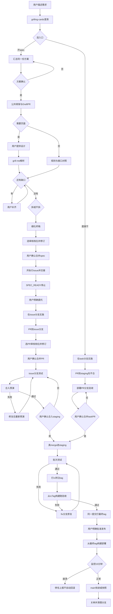

# 一条路：两段流程、阶段事实与衔接

> 本文件是流程顺序与状态的唯一正文。闸口的批准/停止判据见 [gate-details](gate-details.md)，交付信息见 [phase-handoff](phase-handoff.md)，完成判据见 [done-criteria](done-criteria.md)。指南与历史记录不另定义顺序（依据：rationale R37）。

## 一、方案期

### 入口与同一方案

新需求第 1 步必须调用 `grilling-cards` 澄清：按设计树、轮次、当前 frontier 提问，用选项卡呈现；先查事实，只问用户能定的事；产出「改哪里 / 怎么改 / 带来什么能力或优化」及未决项。不得用普通提问代替；skill 不可用时才退回手动，并在澄清记录写明原因。澄清记录随 spec 或原任务 PR 保留（依据：rationale R38）。

澄清后先判落点，再选入口：读 open issue、已批准范围、标签状态和分支是否已合入 staging。新请求在某个 open issue 的已批准范围内且分支未合入 staging → 续该 issue 分支；命中多个 → 列候选给用户选；无命中且改动边界清楚 → 直接干；无命中且有独立验收或需设计 → 开新 issue / spec；已合入 staging 或已关单 → 不续，走 `fix/<N>` / `fix/<slug>` 或新 issue。agent 查事实、给推荐，用户确认；不猜（依据：rationale R40）。

澄清后由用户选入口。直接干进入实施期，不补造 spec / 执行 issue；采用 staging 线时从 staging 切 `task/<slug>`，改动和测试在 task 分支完成，PR 先不合，部署测试环境验收通过后再走合并闸；无 issue 标签，发布记录手工列该任务。

开 spec 继续汇总同一份方案。未合并规格或 PR 续当前阶段；既有任务按有效委托进入实施期，不重新访谈。入口、有效确认与权限识别统一按闸口正文。

开 spec 后，spec-flow 汇总同一份方案：改哪里、怎么改、解决什么或带来什么能力、目标/非目标、备选代价和验收。专业梳理依赖检查见 [项目接入的依赖边界](apply-to-project.md#梳理技能依赖入口澄清与-plan--analyze)。

方案 No 回澄清与探索，可以重组甚至推翻原做法，不限于局部修改；保留仍有效的事实和决定。实际改变已批准目标/范围/能力时回对应确认，探索本身不授予写规格、实施或交付权限。

### 公共骨架 → 分支分析 → 公共汇合

1. **方案确认后先写公共骨架并开同一 Draft PR**：承接目标、范围、验收及待解决问题，不预定页面分支。不把页面未选当作禁止公共草稿的理由。
2. **再由用户选有页面 / 无页面**：可交互 GUI 才算页面；CLI 输出、导出报表、接口响应本身不算。有页面等待用户完善并提供设计，不代画、不猜完整终稿、不自动转无页面。
3. **在所选分支对照分析**：有页面时，grill-me 结合设计与骨架梳理行为、状态、数据、异常、权限和接口请求/响应/错误/读写；无页面时结合规则、接口、正常/边界/失败或重跑材料分析，不因无 GUI 省略接口或业务缺口。
4. **两支汇合，核待用户决定的缺口**：设计、接口、业务规则、验收均适用。有缺口就由用户补齐或确认，更新同一骨架及对照，回核至没有未决承重问题。
5. **统一选择拆或不拆**：在公共缺口确认后一次完成结构决定，再按所选结构细化终稿。有效结构不重复问；结构实质变化按闸口处理。
6. **终稿 → 送审/合并 → 交接**：可实施性与用户同意送审成立后，同一 Draft 转 Ready；按当份审核、修订及独立合并确认处理。规格合并后开执行 issue，写交付/交接信息与批次视图，阶段到 `SPEC_READY` 后报告并停止，等待明确实施委托。

骨架、对照、终稿是同一规格的成熟度，不是三份文档、三个实施阶段或新增实施计划。分支对照与表达方法见 [规格工作指南](spec-maturity.md)，拆分分析见 [拆分指南](split-large-spec.md)；它们不能另立审批步骤。

## 二、实施期

收到有效委托后，先读项目指令、原任务、当前获批规格和实际相关约束，核最新远端与锁；在原交接区记录授权后认领工作区。认领及 Git 安全执行 [worktree-lock](worktree-lock.md)，采用 `release` 时先读其已选分支形态，避免通用 main/master 与项目映射并存冲突。

一次授权覆盖约定规格全量。在范围内自主组织实现、相关测试和配套文档，不逐普通阶段请求续做；阶段间只报进度。触及已声明停止点则停受影响部分：新岔路/新决定、生产写、不可逆迁移、外部契约变化、范围变化、闭环破裂；批准和恢复按闸口正文，不以方法调整制造重复审批。

采用 staging 线时，从 `origin/staging` 开 `issue/<N>` 工作区；每份实现 PR 只合入该 issue 分支，按当份审核、修订和独立合并确认交付，合入后回填全部实际来源与通过证据。开发完成（预期交付都有对应 PR 且构建通过）提议「待测试」；issue 分支按 spec 验收路径测试通过，提议「测试完成」。标签由 agent 读事实、给证据、摆卡，用户确认后换。不因实现 PR 已合就跳到完成。

整条 issue 合入 staging 前先做合入预演：把当前 staging 合入 issue 分支（或临时预演分支），在合并后的树上构建并跑本 issue 验收；同时核 spec、实现/测试、文档、依赖四类是否齐全。预演绿、四类齐、issue 分支测试通过，才进整条合入闸；用户单独确认后用真 merge 合入 staging，不 squash，标签转「待上线」且不可逆，分支冻结。批次测试在 staging HEAD 上跑；失败切 `fix/<N>` 修，标签不回退。

批次测试通过后打 rc 附注 tag，从该 tag 构建、部署测试环境跑验收；rc 不做 15 分钟监控。验收通过才在同一提交打最终 tag。生产发布需用户明确批准；从最终 tag 构建部署，启动 Monitor 15 分钟，崩溃则 HALT、停住上报，不自动回滚。生产验证通过后 main 快进到同一提交；分叉按快照方法。

直接干：采用 staging 线时从 staging 切 `task/<slug>`，改动和测试在 task 分支完成；PR 提到 staging 但先不合，部署 PR 分支到测试环境验收，通过后再走合并闸。无 issue 标签，发布记录手工列该任务（分支、PR、commit、验收证据）。批次失败切 `fix/<slug>`。

hotfix：从生产 tag 切 `hotfix/<tag>-<slug>`，只修该问题并在分支验证；不立即打生产 tag，经闸口合回 staging，跟下一班车发布。

不采用 `release` 时不增加分支、tag 或发布义务；采用单主线/既有三层形态时按 [Git 分支流程与发布](release-discipline.md) 的映射执行，staging 线只在项目入口声明采用时启用。无部署义务的文档在所需分支交付及验收完成后可结束，保留待下次正常快照；仍有部署义务的代码不借此提前完成。最终完成和例外只由 done-criteria 判定。

## 三、阶段事实与衔接

保留既有状态名，不增加第三段或另一套执行状态机。交接区正文保存当前状态，标签仅为已采用项目的辅助视图。

| 状态 | 当前阶段事实 | 后续衔接 |
|---|---|---|
| `DESIGNING` | 澄清、公共 Draft、分支对照、公共缺口、结构选择或终稿尚在进行 | 可实施且同意送审 → `SPEC_REVIEW` |
| `SPEC_REVIEW` | 本份规格待审、修订或待独立合并；规格已合但开执行 issue 失败仍在此重试 | 合并及交接成功 → `SPEC_READY`；取消 → `CANCELLED` |
| `SPEC_READY` | 方案交付完成，执行 issue 已交接，实施待明确委托 | 有效委托 → `IMPLEMENTATION_AUTHORIZED`；返修/重审 → `SPEC_REVIEW`；取消 → `CANCELLED` |
| `IMPLEMENTATION_AUTHORIZED` | 已接收明确委托、核材料并留授权记录，准备认领 | 认领成功 → `IMPLEMENTING`；失败/撤销 → `SPEC_READY` |
| `IMPLEMENTING` | 已认领，正在实现与验证 | 实施 PR 形成 → `DELIVERY_REVIEW`；触发停止点 → `PAUSED` |
| `DELIVERY_REVIEW` | 实施审核/修订/合并、issue 分支验收、整条合入、批次/rc/部署与回填尚未闭合 | 满足 done-criteria 并回填 → `COMPLETED`；暂停 → `PAUSED` |
| `PAUSED` | 暂停原因、受影响范围、原阶段及恢复条件已记录 | 有效恢复 → 暂停前阶段；取消 → `CANCELLED` |
| `CANCELLED` | 任务取消，记录原因并按锁规则处理 | 用户重开 → 按其选择回 `SPEC_REVIEW` / `SPEC_READY`，不自动恢复实施授权 |
| `COMPLETED` | 约定交付及必要验收完成，回填、关单、放锁收尾 | 不把缺失/未知/失败证据改写成已通过 |

没有委托，`SPEC_READY` 不进入实施状态；报告结束不是状态转移。交接失败不是有效交接报告，不能启用同窗口入口。认领失败回退时保留未生效的旧授权，更新待委托状态；新委托追加而不覆盖历史。返修、接管和授权识别的具体判据只在 gate-details，原记录如何更新只在 phase-handoff。

采用 staging 线时，标签是 `IMPLEMENTING` / `DELIVERY_REVIEW` 的细分视图：进行中、待测试、测试完成、待上线；标签与正文状态冲突时停下报告，不自行选一个继续。标签语义唯一见 [issue-status-labels](issue-status-labels.md)。

## 四、定稿流程图

图固定阶段、汇合与闸口，不把节点中举例的样例数量或写法变成格式闸。`dev / staging / master` 是三层形态示意，未采用或单主线不被强迫走三层；实际起点与 PR 目标由已选映射决定。

