# 一条路：两段流程、阶段事实与衔接

> 本文件是流程顺序与状态的唯一正文。闸口的批准/停止判据见 [gate-details](gate-details.md)，交付信息见 [phase-handoff](phase-handoff.md)，完成判据见 [done-criteria](done-criteria.md)。指南与历史记录不另定义顺序（依据：rationale R37）。

## 一、方案期

### 入口与同一方案

新需求从入口选择进入；直接干进入实施期，不补造 spec / 执行 issue。未合并规格或 PR 续当前阶段；既有任务按有效委托进入实施期，不重新访谈。入口、有效确认与权限识别统一按闸口正文。

开 spec 后，grill-me 辅助需求澄清，spec-flow 汇总同一份方案：改哪里、怎么改、解决什么或带来什么能力、目标/非目标、备选代价和验收。事实先查，只问用户能定的事。专业梳理依赖检查见 [项目接入的依赖边界](apply-to-project.md#方案梳理依赖只约束-plan--analyze)。

方案 No 回澄清与探索，可以重组甚至推翻原做法，不限于局部修改；保留仍有效的事实和决定。实际改变已批准目标/范围/能力时回对应确认，探索本身不授予写规格、实施或交付权限。

### 公共骨架 → 分支分析 → 公共汇合

1. **方案确认后先写公共骨架并开同一 Draft PR**：承接目标、范围、验收及待解决问题，不预定页面分支。不把页面未选当作禁止公共草稿的理由。
2. **再由用户选有页面 / 无页面**：可交互 GUI 才算页面；CLI 输出、导出报表、接口响应本身不算。有页面等待用户完善并提供设计，不代画、不猜完整终稿、不自动转无页面。
3. **在所选分支对照分析**：有页面时，grill-me 结合设计与骨架梳理行为、状态、数据、异常、权限和接口请求/响应/错误/读写；无页面时结合规则、接口、正常/边界/失败或重跑材料分析，不因无 GUI 省略接口或业务缺口。
4. **两支汇合，核待用户决定的缺口**：设计、接口、业务规则、验收均适用。有缺口就由用户补齐或确认，更新同一骨架及对照，回核至没有未决承重问题。
5. **统一选择拆或不拆**：在公共缺口确认后一次完成结构决定，再按所选结构细化终稿。有效结构不重复问；结构实质变化按闸口处理。
6. **终稿 → 送审/合并 → 交接**：可实施性与用户同意送审成立后，同一 Draft 转 Ready；按当份审核、修订及独立合并确认处理。规格合并后开执行 issue，写交付/交接信息与批次视图，阶段到 `SPEC_READY` 后报告并停止，等待明确实施委托。

骨架、对照、终稿是同一规格的成熟度，不是三份文档、三个实施阶段或新增实施计划。分支对照与表达方法见 [规格工作指南](spec-maturity.md)，拆分分析见 [拆分指南](split-large-spec.md)；它们不能另立审批步骤。

## 二、实施期

收到有效委托后，先读项目指令、原任务、当前获批规格和实际相关约束，核最新远端与锁；在原交接区记录授权后认领工作区。认领及 Git 安全执行 [worktree-lock](worktree-lock.md)，采用 `release` 时先读其已选分支形态，避免通用 main/master 与项目映射并存冲突。

一次授权覆盖约定规格全量。在范围内自主组织实现、相关测试和配套文档，不逐普通阶段请求续做；阶段间只报进度。触及已声明停止点则停受影响部分：新岔路/新决定、生产写、不可逆迁移、外部契约变化、范围变化、闭环破裂；批准和恢复按闸口正文，不以方法调整制造重复审批。

实现与验证后形成实施 PR，进入当份交付审核；按用户选档、修订选择及单独合并确认交付。合并后回填原任务的全部实际来源与通过证据，继续必要验收。需测试环境的先验测试环境；需要候选分拣或部署的，按已采用模块继续，不因实现 PR 已合就跳到完成。

不采用 `release` 时不增加分支、tag 或发布义务；采用单主线/三层形态时，按 [Git 分支流程与发布](release-discipline.md) 映射图中的开发、候选和成功快照部分。无部署义务的文档在所需分支交付及验收完成后可结束，保留待下次正常快照；仍有部署义务的代码不借此提前完成。最终完成和例外只由 done-criteria 判定。

## 三、阶段事实与衔接

保留既有状态名，不增加第三段或另一套执行状态机。交接区正文保存当前状态，标签仅为已采用项目的辅助视图。

| 状态 | 当前阶段事实 | 后续衔接 |
|---|---|---|
| `DESIGNING` | 澄清、公共 Draft、分支对照、公共缺口、结构选择或终稿尚在进行 | 可实施且同意送审 → `SPEC_REVIEW` |
| `SPEC_REVIEW` | 本份规格待审、修订或待独立合并；规格已合但开执行 issue 失败仍在此重试 | 合并及交接成功 → `SPEC_READY`；取消 → `CANCELLED` |
| `SPEC_READY` | 方案交付完成，执行 issue 已交接，实施待明确委托 | 有效委托 → `IMPLEMENTATION_AUTHORIZED`；返修/重审 → `SPEC_REVIEW`；取消 → `CANCELLED` |
| `IMPLEMENTATION_AUTHORIZED` | 已接收明确委托、核材料并留授权记录，准备认领 | 认领成功 → `IMPLEMENTING`；失败/撤销 → `SPEC_READY` |
| `IMPLEMENTING` | 已认领，正在实现与验证 | 实施 PR 形成 → `DELIVERY_REVIEW`；触发停止点 → `PAUSED` |
| `DELIVERY_REVIEW` | 实施审核/修订/合并或合并后必要验收、候选交付、部署与回填尚未闭合 | 满足 done-criteria 并回填 → `COMPLETED`；暂停 → `PAUSED` |
| `PAUSED` | 暂停原因、受影响范围、原阶段及恢复条件已记录 | 有效恢复 → 暂停前阶段；取消 → `CANCELLED` |
| `CANCELLED` | 任务取消，记录原因并按锁规则处理 | 用户重开 → 按其选择回 `SPEC_REVIEW` / `SPEC_READY`，不自动恢复实施授权 |
| `COMPLETED` | 约定交付及必要验收完成，回填、关单、放锁收尾 | 不把缺失/未知/失败证据改写成已通过 |

没有委托，`SPEC_READY` 不进入实施状态；报告结束不是状态转移。交接失败不是有效交接报告，不能启用同窗口入口。认领失败回退时保留未生效的旧授权，更新待委托状态；新委托追加而不覆盖历史。返修、接管和授权识别的具体判据只在 gate-details，原记录如何更新只在 phase-handoff。

## 四、定稿流程图

图固定阶段、汇合与闸口，不把节点中举例的样例数量或写法变成格式闸。`dev / staging / master` 是三层形态示意，未采用或单主线不被强迫走三层；实际起点与 PR 目标由已选映射决定。

```mermaid
flowchart TD
    START["用户描述需求"] --> ENTRY{"本次选择哪条入口？"}
    ENTRY -- "开 spec" --> GRILL_PLAN["grill-me：需求澄清<br/>先查事实，只问用户能定的事并给推荐"]
    GRILL_PLAN --> PLAN["spec-flow 汇总同一份方案<br/>改哪里、怎么改、目标范围与验收"]
    PLAN --> CONFIRM{"用户确认方案？"}
    CONFIRM -- "否：继续探索，可重构方案" --> GRILL_PLAN
    CONFIRM -- "是" --> DRAFT["写公共 spec 骨架<br/>开同一份 Draft PR"]
    DRAFT --> PAGE{"是否需要页面设计？"}
    PAGE -- "是" --> DESIGN["用户完善并提供页面设计<br/>期间等待，不猜终稿"]
    DESIGN --> GRILL_ANALYZE["grill-me：结合设计与骨架解析<br/>交互、状态、数据、异常、权限与接口"]
    PAGE -- "否" --> EXAMPLE["结合骨架分析规则与接口<br/>用可判对错的样例对照"]
    GRILL_ANALYZE --> GAPS{"是否还有待用户确定的缺口？<br/>设计、接口、业务规则或验收"}
    EXAMPLE --> GAPS
    GAPS -- "有" --> USER_FILL["用户补齐信息或确认口径<br/>有页面时同步完善设计"]
    USER_FILL --> RECHECK["更新同一骨架与对照解析"]
    RECHECK --> GAPS
    GAPS -- "没有" --> SPLIT["用户统一选择拆或不拆"]
    SPLIT --> REFINE["按所选结构细化同一终稿"]
    REFINE --> SPEC_READY["终稿达到可实施标准<br/>用户同意送审"]
    SPEC_READY --> SREVIEW["用户选择本份审核档位<br/>按选择审核和修订"]
    SREVIEW --> SMERGE["用户单独确认合并<br/>方案 PR 合入开发主线"]
    SMERGE --> ISSUE["创建执行 issue<br/>获批依据、预期交付、来源、依赖与证据"]
    ISSUE --> AUTHORIZE["用户明确委托实施"]
    AUTHORIZE --> WORK["在任务工作区实施<br/>完成实现、必要测试与配套文档"]
    ENTRY -- "直接干" --> DIRECT["原任务 PR 承接交付范围<br/>不补造 spec 或执行 issue"]
    DIRECT --> WORK
    WORK --> TEST{"检查与测试通过？"}
    TEST -- "否" --> WORK
    TEST -- "是" --> IREVIEW["用户选择本份实施审核档位<br/>按选择审核和修订"]
    IREVIEW --> IMERGE["用户单独确认合并<br/>实现 PR 合入开发主线"]
    IMERGE --> RECORD["回填原 issue 或任务 PR<br/>全部实际来源、文档位置及通过证据"]
    RECORD --> ACCEPT["完成任务必要验收<br/>需测试环境的先验测试环境"]
    ACCEPT --> READY{"当前任务与必要依赖已就绪？"}
    READY -- "否" --> FIX["补齐交付或验收"]
    FIX --> WORK
    READY -- "是；三层形态" --> READ["分拣者读预期与全部来源<br/>spec、实现/测试、文档、依赖及证据"]
    READY -- "未采用/单主线" --> LOCALEND["按已选形态完成必要交付<br/>完成判据不变，不新增三层义务"]
    READ --> SOURCES{"记录齐全且来源可核？"}
    SOURCES -- "否" --> FILL["补原记录或缺失交付<br/>不靠猜标成完整"]
    FILL --> READ
    SOURCES -- "是" --> PICK["从 dev 按任务挑入候选<br/>不整段合 dev，已有内容只核验"]
    PICK --> COMPLETE{"候选四类交付物齐全？"}
    COMPLETE -- "否" --> FILL
    COMPLETE -- "是" --> PREVIEW["挑选 PR 按原闸口审核修订<br/>用户单独确认合并"]
    PREVIEW --> STAGING["合入 staging 并回填<br/>结果提交及四类核对结论"]
    STAGING -. "无部署义务且验收完成" .-> DOCEND["任务可完成，内容留 staging<br/>随下次正常版本留快照"]
    STAGING --> BATCH["选择正常发布批次<br/>核范围、依赖与当前实际补丁"]
    BATCH --> APPROVE["用户明确批准本批发布"]
    APPROVE --> TAG["固定完整候选提交<br/>创建或核对不可变 tag"]
    TAG --> BUILD["从 tag 构建<br/>核产物与实际部署身份"]
    BUILD --> DEPLOY["按原流程部署与验证"]
    DEPLOY --> SUCCESS{"达到本批成功要求？"}
    SUCCESS -- "否" --> FAIL["按既有失败流程处理<br/>不推进 master 成功快照"]
    SUCCESS -- "是" --> SNAPSHOT["master 留同一 tag 成功快照<br/>spec、实现与文档一起保留"]
    SNAPSHOT --> CLOSE["回填结果，按完成判据分拣关单"]
```

